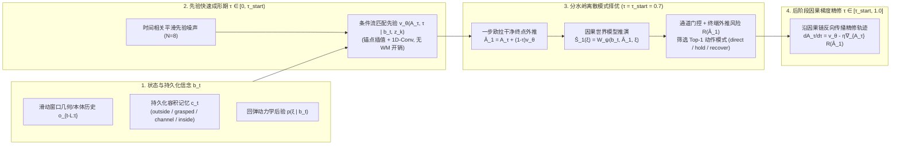

# Causal World-Model Guided Flow Matching for Transient-Condition Manipulation

> **面向易失效操作条件（Transient / Fragile Preconditions）的动作条件因果世界模型与后阶段流匹配引导框架**  
> **Simulation Backend**: IsaacLab / PhysX (Bimanual ALOHA)  
> **Current Milestone**: Phase 1 Quantitative Mechanism Benchmark Completed (`v1` $\to$ `v4`) | Advancing to Phase 2 (Single-Video Task Prompting) & Phase 3 (Flagship Deformable Bag-Packing Demo)

---

## 1. 研究背景与核心科学问题 (Motivation & Problem Formulation)

在接触丰富、多阶段的灵巧/双臂操作任务中（例如：**将多个物品按序放入带弹簧回弹的盒中**，或**撑开易塌陷的软包/背包袋口将物品装入包内**），机器人面临一个传统模仿学习（ACT、Diffusion Policy、标准 Flow Matching）难以处理的共性难题——**操作条件的瞬态易失效性（Transient Precondition Decay）**：

1. **条件在动作执行中途失效**：在时刻 $t$ 准备插入物品时，盒盖或包口处于敞开状态（当前几何净空 $d_{\text{clear}, t} > d_{\text{safe}}$）；但在未来 $H$ 步动作块执行过程中，未知或变化的外部动力学（如盒盖回弹刚度 $\kappa \in \{0, \kappa_{\text{slow}}, \kappa_{\text{fast}}\}$ 或包口柔性回缩）会导致通道在物品完全进入前闭合，造成夹手或装入失败。
2. **闭盖/封口后的双重遮挡困境**：
   - **目标歧义（Goal Ambiguity）**：任务完成闭盖后，容器内部不可见，仅凭最终目标图像（Goal-Image）无法区分盒内放入了什么物品以及放入的先后顺序；
   - **执行记忆丢失（Execution Memory Loss）**：当单次装物耗时超过固定观测窗口长度 $L$ 后，仅靠滑动窗口历史 $o_{t-L:t}$ 无法得知前序物品是否已安全落底。
3. **联合状态-动作生成的“虚假安全幻觉”（State Hallucination in Joint Generation）**：若简单令生成模型同时输出动作与未来状态 $X_\tau = (A_\tau, S_\tau)$ 并对状态违规施以梯度惩罚 $\nabla_{X_\tau} J(S_\tau)$，由于 $\nabla_{A_\tau} J(S_\tau) = 0$，网络会直接篡改预测出的未来状态（将未来盒盖预测为“始终敞开”），而输出的真实物理动作仍然直接撞向正在回落的盒盖。

---

## 2. 核心方法设计 (Core Methodology)

针对上述三个问题，本项目构建了 **“持久化遮挡信念 + 动作条件因果世界模型 + $\tau_{\text{start}}$ 后阶段混合因果引导”** 的统一架构：



### 四项核心技术机制

1. **严格因果方向的世界模型 $W_\psi(b_t, \hat{A}_1, \xi)$**：
   废除联合状态生成，强制未来 $H=24$ 步的条件状态序列 $\hat{S}_1 = (d_{\text{clear}}, \phi_{\text{occ}}, p_{\text{prog}}, c_{\text{col}})_{t+1:t+H}$ 只能作为**干净动作块终点估计 $\hat{A}_1$** 与环境动力学后验 $\xi \sim p(\xi \mid b_t)$ 的因果输出。
2. **通道占用门控（Channel-Occupancy Gating $\phi_{\text{occ}}$）**：
   净空违规惩罚 $\phi_{\text{occ}, t+\delta} \cdot \max(0, d_{\text{safe}} - d_{\text{clear}, t+\delta})^2$ 仅在物体实际占用盒口通道（$\phi_{\text{occ}} \to 1$）时生效。当策略选择**将右臂与物体撤回盒外（$\phi_{\text{occ}} \to 0$）**时，允许盒盖自然落下而不产生惩罚，从而在数学上支持“撤回避让 $\to$ 重新掀盖扶住 $\to$ 再次插入”的恢复闭环。
3. **终端剩余时间净空外推项（Terminal Extrapolated Clearance Risk $J_{\text{term}}$）**：
   利用 24 步预测窗口后半段的净空闭合速率 $\dot{d}_{\text{close}}$ 与末端未完成进度 $(1 - p_{\text{prog}, t+H})$ 外推完成插入前的最小净空 $\hat{d}_{\text{proj}}$，解决有限预测时域（$0.80\text{ s}$）面对慢速回弹（$0.933\text{ s}$）时的**有限时域短视效应（Horizon Myopia）**。
4. **$\tau_{\text{start}} = 0.7$ 后阶段混合因果引导（Late-Stage Hybrid Causal Guidance）**：
   - 在 $\tau \in [0, 0.7)$ 的早期噪声阶段，单步线性外推 $\hat{A}_1$ 误差为 $O((1-\tau)^2)$ 且易偏离动作流形，因此前 70% 步数仅并行推进轻量先验粒子，不调用世界模型；
   - 在 $\tau = 0.7$ 处，动作轮廓已成型且剩余流时间 $(1-\tau)=0.3$ 极短，一步外推即可准确评估各分支风险并完成离散大模式切换（如从单手直接插入切换为双手协同扶盖）；
   - 在 $\tau \in [0.7, 1.0]$ 的最后 30% 步数中，通过因果链 $\frac{\partial W_\psi}{\partial \hat{A}_1}$ 施加连续梯度微调，兼顾低延迟与防碰撞精度。

---

## 3. Phase 1 实验成果与四轮迭代发现 (Key Empirical Findings)

在 IsaacLab / PhysX CPU 双臂 ALOHA 台架上，我们对三档盒盖回弹动力学（`static`: $0.0\text{ N}\cdot\text{m/rad}$，无回弹；`slow`: $0.06\text{ N}\cdot\text{m/rad}$，$0.933\text{ s}$ 闭合；`fast`: $0.62\text{ N}\cdot\text{m/rad}$，$0.083\text{ s}$ 强回弹）开展了四轮严谨的递进实验（完整报告见 [`outputs/Phase1_实验报告_v1.md`](outputs/Phase1_实验报告_v1.md) 至 [`outputs/Phase1_实验报告.md`](outputs/Phase1_实验报告.md)）。

### 成果一：时序锚点架构与动作平滑性是流匹配闭环控制的前提 (`v1` $\to$ `v2`)
- **发现**：首轮（`v1`）采用扁平 MLP 与独立高斯白噪声去噪时，右手相邻控制步（$33.3\text{ ms}$）的目标位姿跳变中位数高达 **`52.6 mm`**（最大 `188.1 mm`），导致机械臂在盒口剧烈抽搐，闭环成功率为 `0%`。
- **解决与验证**：在 `v2` 中引入**锚点线性插值 + 1D 时序卷积 + 相邻步速度差分正则 + 时间相关先验噪声**，并将单步目标位移上限约束在 $7.5\text{ mm}$ 内，相邻步跳变中位数从 **`52.6 mm` 降至 `7.50 mm`**，闭环装盒成功率直接从 **`0.0%` 跃升至 `100.0%`（9/9）**。

### 成果二：实验坐实联合生成基线 (`M2`) 的“虚假安全幻觉” (`v2` & `v3`)
- **诊断设计**：对比 `M2 (Joint-FM-DirectS)`（联合生成 $(A_\tau, S_\tau)$ 并对预测状态施加风险梯度 $-\eta\nabla_{S_\tau} J(S_\tau)$）与我们的因果世界模型方法 `M4-b`。
- **实测证据**：在 `v2` 闭环测试中，`M2` 发生实际物理夹碰的 **10 个执行前缀里，有 9 个（90%）被 `M2` 自身的联合状态头预测为“峰值冲量低于碰撞阈值（$<0.004\text{ N}\cdot\text{s}$）”**！同时 `M2` 在强回弹/慢回弹档的装盒成功率跌至 `66.7%`。这从实验上直接证明了：不经过动作条件因果动力学 $S = W_\psi(b, A)$ 约束的联合引导，会通过“篡改预测状态”来逃避损失函数，而非真正修正危险动作。

### 成果三：$\tau_{\text{start}}$ 介入起点的“U型安全曲线”与“倒U型成功曲线” (`v3` & `v4`)

我们在包含后验条件先验的闭环配置（`v3`，见 [`outputs/evaluation/results_v3.md`](outputs/evaluation/results_v3.md)）与剥离先验后验并注入交接前松手扰动的极限配置（`v4`，见 [`outputs/evaluation/results.md`](outputs/evaluation/results.md)）下，对 $\tau_{\text{start}} \in \{0.0, 0.3, 0.5, 0.7, 0.9, 1.0\}$ 进行了完整扫描：

#### (A) `v3` 消融结果：夹碰率呈标准 U 型曲线（两头高、中间 `0.7~0.9` 最低）

| $\tau_{\text{start}}$ | 回合数 $n$ | 装盒成功率 (%) | 夹碰率 (%) | 回合总代价 | 推理耗时 (ms/块) | WM 批调用/块 | 机理归因 |
| :---: | :---: | :---: | :---: | :---: | :---: | :---: | :--- |
| **0.0** (全程引导) | 9 | 88.9% | 22.2% | 33.18 | 68.00 ms | 11.0 | **介入过早**：噪声期一阶外推失真，破坏动作流形导致成功率受损且耗时最高 |
| **0.3** | 9 | 100.0% | 22.2% | 35.01 | 51.07 ms | 8.0 | 早期梯度仍受未成型轨迹干扰 |
| **0.5** | 9 | 100.0% | 22.2% | 35.68 | 38.70 ms | 6.0 | 过渡区间 |
| **0.7** (默认甜点) | 9 | **100.0%** | **11.1% (1/9)** | **35.05** | **28.06 ms** | **4.0** | **甜点区**：夹碰率减半，推理速度比全程引导提升 **2.4 倍** |
| **0.9** (后期精修) | 9 | **100.0%** | **0.0% (0/9)** | **34.37** | **15.35 ms** | **2.0** | **全场最佳**：**100% 成功 + 0% 夹碰 + 最低总代价**，速度提升 **4.4 倍** |
| **1.0** (`M3` 纯择优) | 9 | 100.0% | 22.2% (2/9) | 35.79 | 9.14 ms | 1.0 | **介入过晚**：退化为纯离散 Best-of-$N$，失去连续梯度微调，夹碰率再次反弹 |

#### (B) `v3` 主矩阵关键对比（`static` 省力 vs. `fast` 防夹）
- **在 `static`（无回弹）档**：`M4-b` ($\tau_{\text{start}}=0.7$) 成功率 **100%**、夹碰率 **0.0%**，左手扶盖时间仅 **`18.97 s`**（全场最低总代价 **`34.45`**，显著优于无引导 `M1` 的 `35.19` 和死板全程扶盖 `B1` 的 `37.46`），证明模型在确认盒盖不会回落后主动释放左臂以降低协同代价。
- **在 `fast`（强回弹）档**：`M4-b` 成功率 **100%**、夹碰率 **0.0%**，且总代价 **`33.04`** 优于 `M1`（`33.26`）、`M2`（`33.11`）、`B1`（`35.21`）及 `B2`（100% 夹碰）。

#### (C) `v4` 极限压测结果：无后验先验 + 4 步预松手交接下的倒 U 型成功率曲线与离线 100% 排序
在 `v4`（[`outputs/Phase1_实验报告.md`](outputs/Phase1_实验报告.md)）中，我们将动力学后验 `xi_prob` 从 Flow 先验网络完全剥离，并在交接前强制松手 4 步（$0.133\text{ s}$）：
1. **交接时刻动力学辨识与离线因果排序 100% 准确**：后验分类准确率达到 **12/12 (100%)**；在留出种子 `108/109` 上，世界模型 + 终端外推风险在 `static` 档坚定优选 `direct`（`-1.320 < -0.584`），在 `slow` 档坚定优选 `hold`（`-0.565 < -0.115`）。
2. **$\tau_{\text{start}} = 0.7$ 成为唯一保持 100% 装盒成功率的甜点**：在 `v4` 严苛扰动下，$\tau_{\text{start}}$ 从 `0.0 -> 0.3 -> 0.5 -> 0.7 -> 0.9 -> 1.0` 的闭环装盒成功率走出标准倒 U 型曲线：**`66.7% -> 77.8% -> 88.9% -> 100.0% (τ=0.7) -> 77.8% -> 66.7%`**。
3. **半落恢复（Perturbed Recovery）100% 完成撤回与重开**：在盒盖已回落至半闭状态（`slow` 释放 18 步、`fast` 释放 4 步并探入）的突袭测试中，`M4-b` 在 `slow` 和 `fast` 下均实现 **100%（6/6）撤回重开并完成双物装盒**（优于 `M1` 的 `5/6` 与 `M3` 的 `4/6`）。
4. **揭示“离线排序正确 $\neq$ 闭环重接触零碰撞”的关键控制缺口**：在 `v4` 中，由于交接前强制松手 4 步（$0.133\text{ s}$，已超过 `fast` 档 $0.083\text{ s}$ 的闭合时间），左臂在重新追赶接触已加速下落的盒盖过程中（12 步重接触段）仍会产生瞬态接触冲量，且 `90 mm` 的高预警净空使梯度在全区间饱和。这一对照清晰界定了**先验多模态覆盖与闭环滚动重接触控制**的边界。

---

## 4. 仓库结构与快速复现 (Repository Layout & Reproduction)

```text
.
├── scene.py              # IsaacLab / PhysX 双臂 ALOHA 与三档可调弹簧阻尼回弹盒物理场景
├── robot.py              # 双臂末端轨迹追踪与逆运动学 (IK) 控制器
├── control.py            # 动作步长限幅 (7.5mm/step) 与释放锁存参数
├── collect.py            # 混合策略轨迹采集 (direct / hold / delayed / recover) 与遮挡信念更新
├── learn.py              # 锚点插值 + 1D-Conv 条件流匹配 (Flow/Joint) 与 GRU 因果世界模型训练
├── inference.py          # τ_start 两阶段混合因果引导采样器与通道门控/终端外推风险计算
├── evaluate.py           # 闭环主矩阵、τ_start 消融实验与半落恢复 (Perturbed Recovery) 评测
├── terminal_probe.py     # 留出集离线候选动作风险排序与交接动力学后验审计
├── report.py             # 实验结果 Markdown 自动汇总生成器
├── run.py                # 统一命令行入口 (calibrate / collect / gate / evaluate)
├── docs/
│   └── Phase1_Top_Level_Spec.md   # Phase 1 数学建模与顶层设计规范
└── outputs/
    ├── Phase1_实验报告_v1.md       # 首轮诊断报告 (暴露阶段污染与 52.6mm 跳变)
    ├── Phase1_实验报告_v2.md       # 第二轮报告 (100% 成功率，验证 M2 90% 虚假安全幻觉，发现慢速档短视)
    ├── Phase1_实验报告_v3.md       # 第三轮报告 (加入终端外推项，跑出 τ_start U型零碰撞甜点曲线)
    ├── Phase1_实验报告.md          # 第四轮封版报告 (剥离先验后验、100% 离线排序与半落恢复压测)
    └── evaluation/
        ├── results_v2.md          # v2 闭环评测汇总表
        ├── results_v3.md          # v3 闭环评测汇总表 (含 U 型消融曲线)
        └── results.md             # v4 闭环评测汇总表 (含 Perturbed Recovery 子表)
```

### 复现命令 (PowerShell)

```powershell
$py = 'C:\isaacsim_env\Scripts\python.exe'

# 1. 物理铰链回弹标定
& $py run.py calibrate --out outputs/repro/calibration

# 2. 混合交互轨迹采集 (10 组种子 x 3 档动力学 x 4 分支 = 120 回合)
& $py run.py collect --out outputs/repro/dataset --first-seed 100 --groups 10

# 3. 监督训练 Flow 策略、Joint 诊断基线、后验编码器与因果世界模型
& $py learn.py --raw outputs/repro/dataset --out outputs/repro/trained --train 100 101 102 103 104 105 --val 106 107 --test 108 109 --steps 1800

# 4. 离线连续性探针与闭环准入门槛检验
& $py terminal_probe.py --raw outputs/repro/dataset --out outputs/repro/trained --model outputs/repro/trained/model.pt --val-seeds 106 107 --test-seeds 108 109
& $py run.py gate --out outputs/repro/gate --model outputs/repro/trained/model.pt --eval-seeds 55 56 57

# 5. 运行完整闭环评测矩阵、τ_start 消融与半落恢复测试
& $py run.py evaluate --out outputs/repro/evaluation --model outputs/repro/trained/model.pt --eval-seeds 60 61 62
```

---

## 5. 后续研究展望与论文路线图 (Future Outlook & Paper Roadmap)

> **最新完整架构设计与三阶段实验规划文档**：请参见 [`docs/Phase2_Unified_Mamba_GPC_Roadmap.md`](docs/Phase2_Unified_Mamba_GPC_Roadmap.md)（包含 **统一双向时序 Mamba 世界模型 + 两层解耦升维 ($D_z=128$) + 正面对标 Harvard GPC (IEEE RA-L 2026) 的公开数据集与旗舰动态装包实验规划**）。

基于 Phase 1 机理台架所验证的核心数学机制与发现的控制边界，后续研究将沿以下三个递进阶段推进，最终形成完整的顶会论文：

### Phase 1.5：闭环重接触自适应与滚动时域精调 (Closed-Loop Re-Contact Refinement)
- **非饱和终端屏障校准**：将 `v3` 的非饱和预警净空（$16\text{--}22\text{ mm}$）与 `v4` 的强区分度权重结合，避免梯度在宽净空区过早饱和；
- **自适应执行步长（Adaptive Receding-Horizon Commit）**：当后验检测到高速回弹（$\hat{\omega}_{\text{lid}}$ 较大）时，自动将动作块执行前缀从 `COMMIT = 8` 缩短至 `2~4` 步，消除松手探查窗口与重接触扶盖之间的闭环相位滞后。

### Phase 2：单段演示视频任务提示与闭盖遮挡记忆验证 (Single-Video Prompting & Occlusion Memory)
- **接入测试时单段视频编码器 $V_{\text{demo}} \to \{z_k, \mathcal{C}_k\}_{k=1}^K$**：替换 Phase 1 中给定的阶段编号 `stage`，从单段人类或机器人成功演示视频中自动提取**装入物品目标、先后顺序约束（如“先放物品 A、再放物品 B” vs. “先放 B、再放 A”）**以及各阶段的维持条件 $\mathcal{C}_k = (P_k, I_k, Q_k)$；
- **遮挡记忆消融实验**：在不透明容器长时闭盖遮挡下，定量对比完整信念 $b_t = (o_{t-L:t}, \hat{c}_t, \hat{\xi}_t)$ 与 `Goal-Image Only`（仅看最终闭盖图像）及 `Fixed-Window History`（无持久化容积状态 $\hat{c}_t$）基线在顺序遵循率与防重复抓放上的显著差异。

### Phase 3：旗舰高难度 Demo —— 双臂多物品收纳进易塌陷软包/背包 (Flagship Bag-Packing Demo)
- **从铰接刚体盒跃迁至柔性/半刚性包袋收纳（Deformable / Collapsible Bag Packing）**：
  将我们在机理台架上验证成熟的 **$\tau_{\text{start}} = 0.7$ 后阶段因果世界模型引导** 迁移至最具视觉冲击力与实用价值的旗舰场景——**双臂将多件日常物品（如耳机盒、书本、水杯）按演示要求装入易塌陷或带弹性包口的背包/收纳袋中**。
- **视觉/点云包口有效孔径预测（Visual Aperture Clearance World Model）**：
  将世界模型预测的标量盒口净空 $d_{\text{clear}}$ 推广为从深度图/点云提取的**包口三维有效通行孔径（Effective Aperture Clearance）**，使机器人在装包过程中能够预判“松开副手是否会导致软包袋口塌缩卡住书本”，从而自主涌现出**“单手撑包口 + 另一手插物”、“袋口塌缩时及时抽回并双手重新撑开包口”**的高水平双臂灵巧协同行为。
