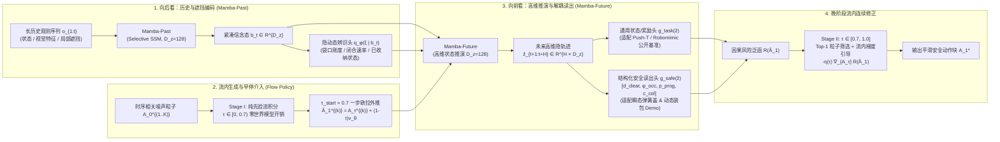

# 统一高维 Mamba 世界模型与流内因果引导：详细架构设计及论文推进规划

> [!IMPORTANT]
> **核心定位（正面对标 Harvard GPC, IEEE RA-L 2026）**
> Harvard 的 **GPC**（`GPC-RANK` / `GPC-OPT`）证明了“冻结生成策略 + 动作条件世界模型（专家数据 + 随机探索数据训练）”在推理时增强策略的有效性，但其存在两大结构性瓶颈：
> 1. **后验割裂（Post-hoc Decoupling）**：必须等生成模型走完 $100\%$ 步数（$\tau=1.0$）后才在流形外筛选或硬拉梯度，易偏离合法运动流形且计算冗余；
> 2. **维度极端化（Dimension Extremes）**：要么只预测低维刚体位姿，要么暴力扩散生成 $96\times 96\times 3$ 全像素图像再过 ResNet 算单标量奖励，导致决策周期高达 **11.7 秒 ~ 374 秒**（无法应对亚秒级瞬态物理窗口）。
>
> **我们的破局方案**：提出 **Unified Past-to-Future Mamba World Model with Late-Stage In-Flow Guidance ($\tau_{\text{start}}=0.7$)**——用统一的 **Mamba（选择性状态空间模型）** 在 **$D_z=128/256$ 维通用隐状态空间** 完成“长历史遮挡记忆（向后看）”与“反事实轨迹推演（向前看）”，通过 **两层解耦读出头** 同时兼容通用公开数据集（Push-T / Robomimic）与高危瞬态受限任务（弹簧盖 / 动态袋口收纳），并将单次规划延迟控制在 **10~25 ms（比 GPC 快 2~3 个数量级）**。

---

## 一、 总体架构设计：双向时序 Mamba + 两层解耦升维世界模型

---

## 二、 核心模块与数学形式化（清爽 6 公式体系，无需繁琐定理证明）

参照 IEEE RA-L / CoRL 的高可读性标准，全篇论文只需以下 **6 个核心方程** 即可完整定义整个框架：

### 1. 模块一：向后看——基于选择性状态空间（Mamba-Past）的历史与遮挡编码
在长时序操作（如连续收纳多个物品、中间存在包口闭合遮挡）或非平稳动态下，单帧观测 $o_t$ 不满足马尔可夫性。我们采用离散化选择性状态空间模型（Mamba）扫描历史观测特征序列 $e(o_{1:t})$：
$$b_t = \mathrm{Mamba}_{\mathrm{past}}\big(e(o_{1:t})\big) \in \mathbb{R}^{D_z}, \qquad \hat{p}(\xi \mid b_t) = \mathrm{Softmax}\big(W_\xi b_t\big) \tag{1}$$
- **为什么用 Mamba 替代固定窗口 MLP / 普通 GRU**：
  Mamba 的输入依赖选择门（Input-Dependent Selection Gate $\Delta_t, B_t, C_t$）具备天然的归纳偏置——在漫长的准静态移动帧中自动衰减无关历史，而在发生物理接触、盖子松手或物品入袋的关键瞬态帧打开记忆门，将百步以上的长程信息压缩进固定维度 $b_t \in \mathbb{R}^{D_z}$（默认 $D_z = 128$）。

### 2. 模块二：向前看——主干升维与两层解耦世界模型（Mamba-Future）
为了解决“只预测 4 维手工状态导致通用性受限”的问题，我们将世界模型解耦为 **高维通用动态主干（Tier-1）** 与 **可插拔任务读出头（Tier-2）**：

- **Tier-1：高维隐状态滚动推演（与具体任务几何解耦）**
  以历史信念态 $b_t \in \mathbb{R}^{D_z}$ 和隐动态模态 $\xi$ 初始化未来状态空间，沿候选动作序列 $\hat{A}_1 = (\hat{a}_{t}, \dots, \hat{a}_{t+H-1})$ 向前递推 $H$ 步高维表征 $\hat{z}_{t+1:t+H} \in \mathbb{R}^{H \times D_z}$：
  $$\hat{z}_{t+k} = \mathrm{Mamba}_{\mathrm{future}}\big(\hat{z}_{t+k-1}, \hat{a}_{t+k-1}, \xi\big) \in \mathbb{R}^{D_z}, \quad \hat{z}_t = \phi_{\mathrm{init}}(b_t, \xi) \tag{2}$$
  训练时，通过重构未来真实状态或视觉编码特征 $e(o_{t+k})$ 提供密集监督（对齐自监督动态损失 $\mathcal{L}_{\mathrm{state}} = \sum_{k=1}^H \|\psi_{\mathrm{obs}}(\hat{z}_{t+k}) - e(o_{t+k})\|_2^2$），确保 $128$ 维隐状态完整捕获物体位姿与环境演化。

- **Tier-2：可插拔任务与结构化安全读出头（Pluggable Readout Heads）**
  在高维隐状态 $\hat{z}_{t+k} \in \mathbb{R}^{D_z}$ 之上挂载轻量级 MLP 读出头 $g_\psi(\hat{z}_{t+k})$：
  $$\hat{y}_{t+k} = g_\psi(\hat{z}_{t+k}) = \begin{cases} \hat{x}_{t+k} \in \mathbb{R}^{D_x} \text{ (预测完整物体位姿/关键点与目标距离)} & \text{【通用公开基准模式：Push-T / Robomimic】} \\ \big[\hat{d}_{\mathrm{clear}}, \hat{\phi}_{\mathrm{occ}}, \hat{p}_{\mathrm{prog}}, \hat{c}_{\mathrm{col}}\big]^\top \in \mathbb{R}^4 & \text{【结构化安全模式：瞬态闭合 / 动态装包】} \end{cases} \tag{3}$$

### 3. 模块三：晚阶段流内因果引导（Late-Stage In-Flow Guidance at $\tau_{\text{start}}=0.7$）
设条件流匹配（Conditional Flow Matching）速度场为 $v_\theta(A_\tau, \tau \mid o_t, c)$，采样 $K$ 条时序相关噪声粒子 $\varepsilon^{(1:K)}$：

1. **Stage I（纯流先验快速去噪，$\tau \in [0, \tau_{\text{start}})$，默认 $\tau_{\text{start}}=0.7$）**：
   仅演化速度场 $v_\theta$，不调用世界模型（省去 $70\%$ 步数上的昂贵世界模型前向/反向传播）：
   $$\frac{d A_\tau^{(k)}}{d\tau} = v_\theta\big(A_\tau^{(k)}, \tau \mid o_t, c\big), \quad \tau \in [0, \tau_{\text{start}}) \tag{4}$$
2. **Threshold Checkpoint（$\tau = \tau_{\text{start}} = 0.7$ 一步清洁终点外推与多粒子筛选）**：
   对每个粒子计算一步欧拉终点映射 $\hat{A}_1(A_\tau) = A_\tau + (1-\tau)v_\theta(A_\tau, \tau \mid o_t, c)$，送入 `Mamba-Future` 评估期望风险泛函 $\mathcal{R}(\hat{A}_1) = \mathbb{E}_{\xi \sim \hat{p}(\xi \mid b_t)}[J(\hat{y}_{t+1:t+H})]$，选出最优粒子 $k^\star = \arg\min_k \mathcal{R}(\hat{A}_1^{(k)})$：
   $$A_{\tau_{\text{start}}} \leftarrow A_{\tau_{\text{start}}}^{(k^\star)} \tag{5}$$
3. **Stage II（流内连续因果梯度修正，$\tau \in [\tau_{\text{start}}, 1.0]$）**：
   仅对选出的单条最优粒子，在流匹配生成的最后 $30\%$ 步数内注入世界模型梯度：
   $$\frac{d A_\tau}{d\tau} = v_\theta(A_\tau, \tau \mid o_t, c) - \eta(\tau) \nabla_{A_\tau} \mathcal{R}\big(\hat{A}_1(A_\tau, \tau)\big), \quad \tau \in [\tau_{\text{start}}, 1.0] \tag{6}$$

---

## 三、 与 Harvard GPC (RA-L 2026) 的全方位对比矩阵

| 维度 | Diffusion Policy (BC) | Harvard GPC-RANK (RA-L 2026) | Harvard GPC-OPT (RA-L 2026) | **Ours (Mamba-WM + In-Flow $\tau_{\text{start}}=0.7$)** |
| :--- | :---: | :---: | :---: | :---: |
| **历史与遮挡记忆 ($o_{1:t}$)** | 固定短窗口 ($H=2$) | 固定短窗口 ($H=2\sim 4$) | 固定短窗口 ($H=2\sim 4$) | **Mamba 选择性长时序状态空间 ($b_t \in \mathbb{R}^{128}$)** |
| **未来世界模型架构** | 无 | MLP 或 递归像素扩散 UNet | MLP 或 递归像素扩散 UNet | **高维 Mamba-Future ($D_z=128$) + 解耦读出头** |
| **规划介入时机** | 无 | $\tau=1.0$ 后验纯采样筛选 ($M=0$) | $\tau=1.0$ 生成结束后流形外单打靶求导 | **$\tau_{\text{start}}=0.7$ 流内离散筛选 + 连续流形内梯度修正** |
| **单次决策推理耗时** | $\sim 5\text{ ms}$ (State) | $5.8\text{ s} \sim 11.7\text{ s}$ (Vision) | $39.0\text{ s} \sim 374.1\text{ s}$ (Vision) | **$\sim 15\text{–}25\text{ ms}$ (支持 30~50Hz 闭环控制)** |
| **应对亚秒级瞬态物理窗口** | ❌ 无前瞻碰撞感知 | ❌ 采样颗粒度粗且推理太慢 | ❌ 严重超时，且流形外优化易抖动 | **✅ 毫秒级流内避障 + 受扰主动撤回重开** |

---

## 四、 后续三阶段执行规划（Step-by-Step Roadmap）

### 阶段一（Stage A）：架构升级与公开数据集对标实验
- **目标**：证明升维后的 `Mamba-Past + Mamba-Future` ($D_z=128$) 架构在不依赖任何手工净空特征的情况下，在国际公认的公开基准上正面击败 **Diffusion Policy**、**GPC-RANK** 和 **GPC-OPT**。
- **选用公开数据集**：
  1. **Push-T（State & Keypoint）**：直接对标 Harvard GPC 论文里的主实验（专家演示 + 随机扰动探索轨迹）；
  2. **Robomimic（如 `Lift` 或 `Can` 低维状态/特征集）**：验证在三维机械臂操作公开数据集上的通用提升。
- **核心实验产出（对应论文 Table 1）**：
  - 对比 `BC (Flow/Diffusion)`、`GPC-RANK (K=100)`、`GPC-OPT (M=25)`、`Early In-Flow (τ=0.0)` 与 **`Ours (Mamba-WM, τ_start=0.7)`** 的任务得分（IoU / Success Rate）、轨迹平滑度（Adjacent Jump）以及单步推理耗时（ms）。
  - 验证 **主干升维消融**：在 Phase 1 弹簧盖与公开任务上对比 $D_z \in \{4, 32, 128, 256\}$ 的预测精度与闭环成功率。

### 阶段二（Stage B）：Mamba 归纳偏置与长程遮挡/瞬态恢复消融
- **目标**：通过控制变量消融实验（无需数学定理证明，用实验曲线说话），证明为什么必须用 **Mamba** 以及为什么 **$\tau_{\text{start}}=0.7$** 最优。
- **核心消融实验（对应论文 Table 2 & Figure 4）**：
  1. **序列归纳偏置对比（`MLP (H=4)` vs. `GRU` vs. `Mamba (Selective SSM)`）**：
     在包含**长等待窗口（$30\sim 100$ 步）**与**中途视觉遮挡（盖子/袋口短暂挡住内部）**的任务中，展示 MLP 因窗口截断失忆、普通 GRU 因梯度遗忘退化，而 `Mamba` 保持近 $100\%$ 隐状态与动态辨识准确率；
  2. **$\tau_{\text{start}} \in \{0.0, 0.3, 0.5, 0.7, 0.9, 1.0\}$ 帕累托前沿曲线**：
     在公开数据集与弹簧盖任务上同时复现“成功率倒 U 型峰值在 $\tau_{\text{start}}=0.7$”与“耗时随 $\tau_{\text{start}}$ 线性下降”的双重优势；
  3. **Phase 1.5 弹簧盖完美收官表**：
     用升维后的 `128D Mamba + 结构化安全头` + 自适应短步长重规划（`COMMIT=4`），将弹簧盖闭环碰撞率在全模态下压至 `0%`，同时保持扰动恢复 `100%` 成功。

### 阶段三（Stage C）：旗舰高难度 Demo —— 动态弹性袋口多物品收纳（Deformable/Spring-Mouth Bag Packing）
- **目标**：打造整篇论文最抓眼球的 **Figure 1 首页大图与补充视频 Demo**，展示 GPC 等准静态方法完全无能为力的动态灵巧操作。
- **任务场景设计（IsaacLab 仿真）**：
  - **物理环境**：双臂机器人将多个不同几何形状的物品（如刚性盒 `Object A` + 易碎圆柱 `Object B`）依次收纳进一个带有**弹性回缩袋口（Spring-loaded / Deformable Collar）**的收纳包中。
  - **三大核心难点（恰好对应我们方法的三个模块）**：
    1. **袋口瞬态回弹（Transient Aperture Closure）**：左臂撑开袋口受外力扰动滑脱或松手时，袋口以不同刚度/阻尼参数 $\xi$ 快速回缩，必须靠 `Mamba-Future` 的结构化安全头预测未来净空 $d_{\mathrm{clear}}$ 与袋口冲量 $c_{\mathrm{col}}$；
    2. **包内视觉遮挡与顺序依赖（Occlusion Memory）**：第一个物品放入包底后被袋口遮挡，放第二个物品时必须依靠 `Mamba-Past` 的长时序信念态 $b_t$ 记住包内剩余空间分布，避免挤压已放入物品；
    3. **中途脱手紧急撤回（In-Flight Abort & Re-open）**：当放入物品 B 途中袋口突然快速回弹，依靠 $\tau_{\text{start}}=0.7$ 流内引导在毫秒内切换至 `withdraw -> re-open bag -> re-insert` 恢复闭环。
