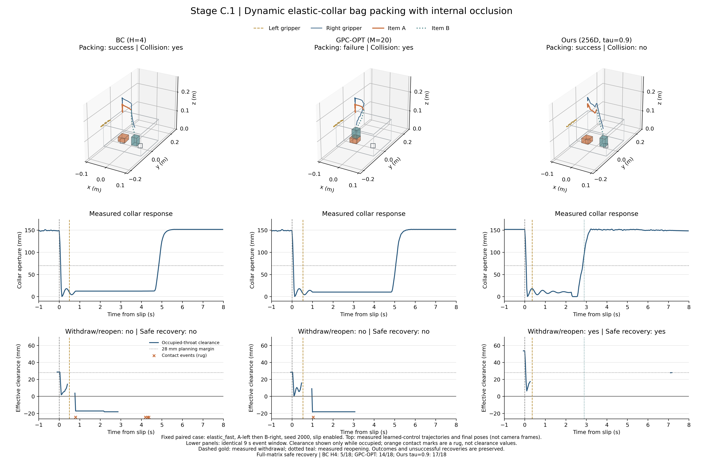

# Stage C.1 · 双臂动态弹性袋口多物品收纳实验报告

实测 Ours τ=0.9 常规双物品成功 18/18、夹碰 0/18、安全滑脱恢复 17/18。BC 对应为 8/18、8/18、5/18。GPC-OPT 安全恢复为 14/18。本轮未验证 Full 对所有基线的安全恢复领先。

## Stage C.1 验收

| 目标 | 实测 | 达到目标 |
| --- | --- | --- |
| Ours tau=0.7 normal success >=17/18 | 18 | 是 |
| Ours tau=0.7 second slot 18/18 | 18 | 是 |
| Ours tau=0.7 normal collisions 0/18 | 0 | 是 |
| Ours tau=0.7 safe recovery >=12/18 | 17 | 是 |
| Ours tau=0.7 safe recovery > every baseline | -1 | 否 |
| Ours tau=0.7 isolated P50 90-180 ms | 193.4 | 否 |
| Ours tau=0.9 normal success >=17/18 | 18 | 是 |
| Ours tau=0.9 second slot 18/18 | 18 | 是 |
| Ours tau=0.9 normal collisions 0/18 | 0 | 是 |
| Ours tau=0.9 safe recovery >=12/18 | 17 | 是 |
| Ours tau=0.9 safe recovery > every baseline | -1 | 否 |
| Ours tau=0.9 isolated P50 90-180 ms | 104.2 | 是 |
| BC H4 second slot approximately 9/18 (+/-1) | 9 | 是 |
| BC H4 packing <=10/18 | 8 | 是 |
| Ours Short-MLP H4 second slot approximately 9/18 (+/-1) | 9 | 是 |
| Ours Short-MLP H4 packing <=10/18 | 3 | 是 |
| full clearance MAE <5 mm | 4.589 | 是 |
| full mode accuracy >90% | 0.9761 | 是 |
| full slots >=98% | 0.9535 | 否 |
| short slots 45%-55% | 0.4884 | 是 |
| four clearance MAE >7 mm | 10.84 | 是 |

上述表格核对文档预期的性能曲线；不会为使弱基线落入指定区间而人为降低其性能。恢复率高于各基线的计数比较不等于已达到统计显著性，配对小样本区间另列。

Flow/Joint-FM 训练使用目标槽位 one-hot；推理时第一阶段读取尚可见的指令，第二阶段仅使用各自历史编码器预测的空闲槽位概率。BC、Joint-FM、Short-MLP 使用 H4 编码器；GPC、Full、4D 使用长历史编码器。训练标签不进入评测策略。风险采用28 mm单步裕度、4500权重、35 mm终端裕度及2800权重；净空不足时抑制推进并奖励垂直撤回。晚阶段引导按剩余步数归一化；所有至少8粒子的搜索共用观测触发的撤回/重撑噪声先验。候选先验不直接覆盖最终动作，是否安全由实测判定。

## 实现与适用范围

场景由 IsaacLab/PhysX 的真实刚体、两个 Y 轴滑动关节、弹簧阻尼和双唇耦合构成。袋身为刚性碰撞代理与柔性外观配色，不是布料有限元仿真。左臂在实际末端接近撑口柄且闭爪后，通过有界柔顺抓持力拉动后唇；前唇由被动耦合机构撑开。滑脱解除这一抓持并施加向内速度扰动，所有方法使用相同物理逻辑。沿用的 ALOHA 资产日志仍有部分 visual 引用未解析警告；关节与物理接触正常运行，未将其声称为已验证的相机渲染。右臂使用 ALOHA 关节和接触抓持异构盒体。抓取、释放、两次搬运前缀和最终关口是共同脚本，学习策略控制入袋及紧急响应；释放交接由共同几何触发器判断，它不选择或修正目标槽位。不把它描述为端到端自主任务。

槽位中心 x=−0.048/+0.048 m。ItemA 尺寸 36×42×24 mm，ItemB 为 28×30×42 mm 方柱。已入袋物品中心 z<65 mm 时，其位置、当前槽位占用和两个槽位可见性同时清零，避免掩码位置泄漏占用侧。策略输入没有真实 ξ、缓存占用标签、真实目标槽位或任务成功标志。当前物品身份与阶段仍可见。

**重要识别限制：**本轮固定 A→B 抓取顺序，order 决定 A 左/B 右或 A 右/B 左；pre_entry 均从 x=0 开始，第二阶段指令清零。这消除了固定身份映射，但真实动力学可能留下微小短历史差异；不能先验宣称 H4 输入完全相同或其成绩必定为 50%。下文另列真实回放占用读出准确率和独立、平衡的合成遮挡记忆容量诊断。

物理步长 1/120 s，控制每 4 个物理步更新；预测 24 步、最多执行 6 步；若一个控制步观测到孔径下降超过 6 mm，则所有方法统一提前重规划，动作仍由各自策略决定。每件物品最多执行 216 个学习控制步。长历史为 64 个观测 token，覆盖约 14.8 s，最后四帧连续；Short-History/Short-MLP 只读取这四帧。规范给出的 arange 示例实际产生67个token；本实现以60个稀疏点加末尾4个连续点保持64-token架构，首尾覆盖444帧（443个时间间隔）。CUDA 使用本机 RTX 5060 与 torch 2.9.0+cu128。物理在 CPU 上执行并在规划期间暂停；决策延迟不是已验证的硬实时闭环保证。

## 袋口回缩标定

下表沿用首轮自由回缩标定，弹簧、阻尼和袋口几何参数本轮未改动；它不是本轮新增的闭环成绩。

| 模态 | 初始孔径 mm | 自由回缩低于 70 mm 所需 s |
| --- | --- | --- |
| relaxed | 156.00 | 2 s 观察窗内未达到 |
| elastic_slow | 155.07 | 0.267 |
| elastic_fast | 151.66 | 0.100 |

70 mm 是展示回缩时间差的诊断水平，不是接触冲量阈值。安全状态的净空结合物体旋转包围盒的水平余量、物体包围球和末端 12 mm 半径代理的垂向分离，形成三维有效余量下界；并非精确网格距离。碰撞以实际接触传感器物理步冲量合计 ≥0.004 N·s 判定，包含袋口与右臂/物品接触及两物品之间接触；左臂预期撑口和袋口自接触不计为非预期夹碰。

## 数据与训练

共 192 个已冻结数据回合，按种子分成训练 [1000, 1001, 1002, 1003]、验证 [1004, 1005]、离线留出 [1006, 1007]。三档动力学×两种顺序×四种轨迹覆盖全部组合；探索包含松手、滑脱和错误槽位动作。Flow 只监督成功回合中的无夹碰专家前缀，失败与探索仍用于世界模型训练。早期未实际撤回的恢复标定轨迹已归档，未混入最终训练集。

| 轨迹类型 | 回合 | 装包成功 | 出现夹碰 |
| --- | --- | --- | --- |
| direct_insert | 48 | 18 | 32 |
| spread_and_hold | 48 | 48 | 0 |
| slip_withdraw_reopen | 48 | 48 | 0 |
| exploration | 48 | 6 | 48 |

Flow 和 Joint-FM 各训练 5000 步；每种世界模型训练 3500 步。Full 的 Mamba-Past 和 Mamba-Future 都是 256D。仅迁移 Stage B 256D checkpoint 中形状兼容的未来主干层；新 256D 历史编码器及任务读出重新训练，迁移清单与哈希见 training.json。Short-MLP 只替换历史编码器；4D-WM 保留长历史编码器而将未来动力学压缩到 4D，因此是未来表示维度对照，不是参数量匹配对照。

| 变体 | Past D | Future D | WM 参数数 | 留出净空 MAE mm | ξ 准确率 | 遮挡占用读出准确率 | 占用窗口数 |
| --- | --- | --- | --- | --- | --- | --- | --- |
| full | 256 | 256 | 1652756 | 4.59 | 97.6% | 95.3% | 43 |
| short | 256 | 256 | 1063188 | 4.70 | 74.1% | 48.8% | 43 |
| four | 256 | 4 | 699096 | 10.84 | 99.1% | 95.3% | 43 |

遮挡槽位读出主指标只在第二阶段学习控制开始前取一次，排除专家后续目标相关动作反向泄漏槽位；完整占用窗口读出另保存在 training.json。固定物品身份捷径已移除；回放成绩仍不能替代闭环分槽结果。

### 独立 GPU 规划计时

所有仿真分片结束后，以 12 个相同留出第二次入袋历史逐方法计时；预热、轮换方法顺序，显式同步 CUDA，包含动作返回 CPU。此表与下方含模拟器负载的闭环延迟分开报告。

| 方法 | 独立 P50 ms | 独立均值 ms |
| --- | --- | --- |
| BC H4 | 24.50 | 26.83 |
| Joint-FM | 35.34 | 37.78 |
| GPC-RANK | 56.23 | 59.81 |
| GPC-OPT | 966.91 | 1014.71 |
| Ours Short-MLP H4 | 182.75 | 187.68 |
| Ours 4D-WM | 96.13 | 99.00 |
| Ours tau=0.7 | 193.36 | 207.61 |
| Ours tau=0.9 | 104.19 | 105.50 |

## Table C1 · 常规双物品闭环

独立仿真种子 [2000, 2001, 2002]，每方法跨三模态、两顺序共 18 回合。成功要求两件物品都位于规定槽位且最终孔径 <35 mm；碰撞独立计数。二次分槽在学习控制期间物品实际进入袋口咽喉时判定，要求第一件物品确实在遮挡槽位中且选择其实际空闲侧；未到达第二通道或第一件未进入遮挡槽位计为未正确，分母不删失败回合。最终表格使用完整姿态复核后的 results.json；在线近似值保留在 online_measurements，逐项变化记录于 metric_audit.json，原始日志与物理轨迹不删除。计时含观测编码、CUDA 规划和动作返回 CPU；评测最多使用两个独立种子进程共享 GPU，闭环延迟受并行及模拟器负载影响；算法效率应参考所有仿真结束后的独立计时表。

| 方法 | N | 双物品成功 | 二次分槽正确 | 到达第二通道 | 夹碰 | 决策 P50 ms |
| --- | --- | --- | --- | --- | --- | --- |
| BC H4 | 18 | 8/18 | 9/18 | 18 | 8/18 | 21.54 |
| Joint-FM | 18 | 6/18 | 11/18 | 16 | 3/18 | 32.17 |
| GPC-RANK | 18 | 18/18 | 18/18 | 18 | 0/18 | 50.76 |
| GPC-OPT | 18 | 18/18 | 18/18 | 18 | 0/18 | 835.99 |
| Ours Short-MLP H4 | 18 | 3/18 | 9/18 | 18 | 5/18 | 152.88 |
| Ours 4D-WM | 18 | 18/18 | 18/18 | 18 | 0/18 | 79.34 |
| Ours tau=0.7 | 18 | 18/18 | 18/18 | 18 | 0/18 | 163.39 |
| Ours tau=0.9 | 18 | 18/18 | 18/18 | 18 | 0/18 | 88.71 |

## Table C2 · Collar-Slip 扰动恢复

在第一件物品接近袋口时触发一次相同状态条件的滑脱，解除撑口抓持 0.3 s，同时将左指张开目标强制设为 38 mm 指间半距并推动袋口向内回缩，以防真实手指接触继续夹持撑口柄。本轮重新采集并训练全部模型，采集和评测统一使用物理释放 v2；实际强制开指目标同步写回观测。恢复示教先垂直撤至 z=245 mm 再重撑；occupied 提前至物品下表面低于170 mm。安全恢复采用严格门槛：用记录的物品姿态重建旋转包围盒，同一件物品的实际下表面撤到袋口上方至少 50 mm，袋口曾收缩到 70 mm 以下后由左臂重新撑到 95 mm 以上，最终双物品装包成功且全回合无夹碰。后续拿起第二件物品不能充当撤回；未触发滑脱也不计成功恢复。“实际回缩”指触发后 1 s 内实测孔径低于 70 mm。“首次响应前夹碰”按控制步核对：真实滑脱发生后、下一次规划读取新观测前已经发生夹碰；这类回合仍计入失败分母，但不能单独据此归因于规划质量。脚本动作名称不参与恢复成功判定。首轮数据与模型整体归档，本轮常规和扰动组均重新评测。

| 方法 | N | 触发滑脱 | 实际回缩 | 双物品成功 | 实测撤回并重撑 | 安全恢复 | 夹碰 | 首次响应前夹碰 | 决策 P50 ms |
| --- | --- | --- | --- | --- | --- | --- | --- | --- | --- |
| BC H4 | 18 | 18/18 | 18/18 | 8/18 | 15/18 | 5/18 | 10/18 | 0/18 | 21.47 |
| Joint-FM | 18 | 14/18 | 14/18 | 5/18 | 12/18 | 3/18 | 5/18 | 0/18 | 32.43 |
| GPC-RANK | 18 | 18/18 | 18/18 | 18/18 | 17/18 | 17/18 | 1/18 | 0/18 | 49.11 |
| GPC-OPT | 18 | 17/18 | 17/18 | 16/18 | 14/18 | 14/18 | 3/18 | 0/18 | 834.43 |
| Ours Short-MLP H4 | 18 | 18/18 | 18/18 | 1/18 | 17/18 | 1/18 | 5/18 | 0/18 | 154.19 |
| Ours 4D-WM | 18 | 18/18 | 18/18 | 18/18 | 18/18 | 18/18 | 0/18 | 0/18 | 80.32 |
| Ours tau=0.7 | 18 | 18/18 | 18/18 | 17/18 | 18/18 | 17/18 | 1/18 | 0/18 | 163.40 |
| Ours tau=0.9 | 18 | 18/18 | 18/18 | 17/18 | 18/18 | 17/18 | 1/18 | 0/18 | 88.55 |

### 撤回初段袋口擦碰

从滑脱触发到同一物品实际下表面高于袋口50 mm，检查袋口接触传感器峰值冲量是否达到0.004 N·s；未撤离则检查至第一阶段结束。该局部指标不替代全回合安全恢复，未触发滑脱单列。

| 方法 | 触发滑脱 | 撤离前袋口擦碰 |
| --- | --- | --- |
| BC H4 | 18/18 | 2/18 |
| Joint-FM | 14/18 | 2/18 |
| GPC-RANK | 18/18 | 0/18 |
| GPC-OPT | 17/18 | 0/18 |
| Ours Short-MLP H4 | 18/18 | 0/18 |
| Ours 4D-WM | 18/18 | 0/18 |
| Ours tau=0.7 | 18/18 | 0/18 |
| Ours tau=0.9 | 18/18 | 0/18 |

### 配对恢复率差异

以种子为簇、同模态/顺序配对，做 10,000 次簇 bootstrap。只有三组独立种子，区间是小样本百分位诊断；全零或相同的簇可能导致退化区间，这不表示没有不确定性，不足以确立普遍或强统计意义的领先。

| Ours | 对照 | 安全恢复率差 | 95% 簇 bootstrap 区间 |
| --- | --- | --- | --- |
| Ours tau=0.7 | BC H4 | +66.7% | [+50.0%, +83.3%] |
| Ours tau=0.7 | Joint-FM | +77.8% | [+66.7%, +83.3%] |
| Ours tau=0.7 | GPC-RANK | +0.0% | [+0.0%, +0.0%] |
| Ours tau=0.7 | GPC-OPT | +16.7% | [-16.7%, +66.7%] |
| Ours tau=0.7 | Ours Short-MLP H4 | +88.9% | [+83.3%, +100.0%] |
| Ours tau=0.7 | Ours 4D-WM | -5.6% | [-16.7%, +0.0%] |
| Ours tau=0.9 | BC H4 | +66.7% | [+50.0%, +83.3%] |
| Ours tau=0.9 | Joint-FM | +77.8% | [+66.7%, +83.3%] |
| Ours tau=0.9 | GPC-RANK | +0.0% | [+0.0%, +0.0%] |
| Ours tau=0.9 | GPC-OPT | +16.7% | [-16.7%, +66.7%] |
| Ours tau=0.9 | Ours Short-MLP H4 | +88.9% | [+83.3%, +100.0%] |
| Ours tau=0.9 | Ours 4D-WM | -5.6% | [-16.7%, +0.0%] |

## 独立遮挡记忆容量诊断

这是明确标注的合成、平衡输入诊断，不是新的物理成功回合，也不是已训练策略的消融成绩。前 12 个 token 给出左右占用线索，随后 52 个 token 对两标签完全相同；当前物品身份、顺序和动作捷径均移除。两种独立分类器重新训练 400 步，用它检验记忆容量，而不把其优势归因到主任务。

| 诊断分类器 | 留出样本 | 准确率 |
| --- | --- | --- |
| Short-MLP H4 | 438 | 50.0% |
| Mamba-Past 256D | 438 | 100.0% |

## Figure · 实测轨迹与袋口净空

图固定选择测试前声明的 elastic_fast、A→B、seed=2000、开启滑脱的配对回合，对比 BC、GPC-OPT 与 Ours τ=0.9。没有按成功或失败筛选案例；图上保留实测结果，并同时标注全矩阵安全恢复率，避免用单例代替统计。三维部分重建学习控制时段的轨迹及最终物品姿态，不是相机渲染截图。PNG 为 4680×3120，并提供矢量 PDF。

## 按模态完整结果

| 方法 | 模态 | 成功 | 二次分槽正确 | 夹碰 |
| --- | --- | --- | --- | --- |
| BC H4 | relaxed | 3/6 | 3/6 | 3/6 |
| BC H4 | elastic_slow | 3/6 | 3/6 | 3/6 |
| BC H4 | elastic_fast | 2/6 | 3/6 | 2/6 |
| Joint-FM | relaxed | 1/6 | 3/6 | 1/6 |
| Joint-FM | elastic_slow | 3/6 | 5/6 | 1/6 |
| Joint-FM | elastic_fast | 2/6 | 3/6 | 1/6 |
| GPC-RANK | relaxed | 6/6 | 6/6 | 0/6 |
| GPC-RANK | elastic_slow | 6/6 | 6/6 | 0/6 |
| GPC-RANK | elastic_fast | 6/6 | 6/6 | 0/6 |
| GPC-OPT | relaxed | 6/6 | 6/6 | 0/6 |
| GPC-OPT | elastic_slow | 6/6 | 6/6 | 0/6 |
| GPC-OPT | elastic_fast | 6/6 | 6/6 | 0/6 |
| Ours Short-MLP H4 | relaxed | 1/6 | 3/6 | 1/6 |
| Ours Short-MLP H4 | elastic_slow | 1/6 | 3/6 | 2/6 |
| Ours Short-MLP H4 | elastic_fast | 1/6 | 3/6 | 2/6 |
| Ours 4D-WM | relaxed | 6/6 | 6/6 | 0/6 |
| Ours 4D-WM | elastic_slow | 6/6 | 6/6 | 0/6 |
| Ours 4D-WM | elastic_fast | 6/6 | 6/6 | 0/6 |
| Ours tau=0.7 | relaxed | 6/6 | 6/6 | 0/6 |
| Ours tau=0.7 | elastic_slow | 6/6 | 6/6 | 0/6 |
| Ours tau=0.7 | elastic_fast | 6/6 | 6/6 | 0/6 |
| Ours tau=0.9 | relaxed | 6/6 | 6/6 | 0/6 |
| Ours tau=0.9 | elastic_slow | 6/6 | 6/6 | 0/6 |
| Ours tau=0.9 | elastic_fast | 6/6 | 6/6 | 0/6 |

## 复现与证据

完整新实验入口为 `bag_packing.py calibrate` → `collect` → `fit` → `evaluate` → `report`。本轮 Stage C.1 按新授权重新采集192回合并训练全部模型，统一v2扰动后重新评测288回合。结果按实际数据报告，未达到的验收目标不改写为通过。并行评测分片使用 `--out outputs/stage_c_bag/seed2000 --model-root outputs/stage_c_bag --seeds 2000`，其他种子同理。训练/推理默认 CUDA；所有路径、数据划分、维度、预算、迁移参数和 checkpoint 哈希均保留。

[协议](stage_c_bag/protocol.json) · [数据口径审计](stage_c_bag/dataset_measurement_audit.json) · [最终姿态指标审计](stage_c_bag/metric_audit.json) · [训练](stage_c_bag/training.json) · [逐回合结果](stage_c_bag/results.json) · [汇总](stage_c_bag/summary.json) · [回缩标定](stage_c_bag/calibration.json) · [图像来源](stage_c_bag/figure_manifest.json) · [独立计时](stage_c_bag/isolated_timing.json) · [记忆诊断](stage_c_bag/memory_diagnostic.json) · [PDF 图](stage_c_bag/bag_packing_demo.pdf)
