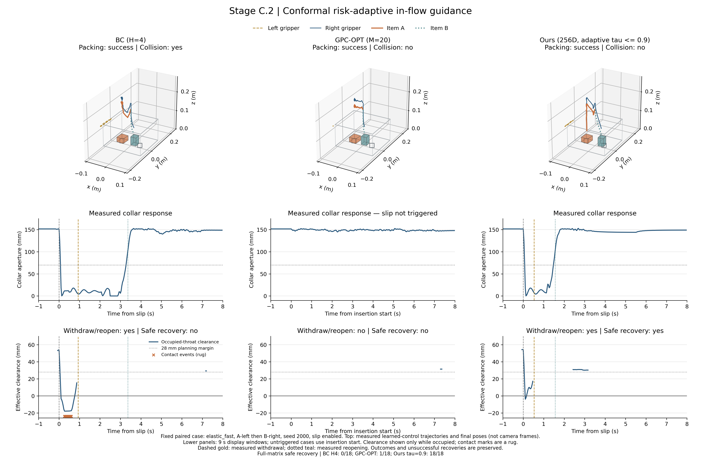

# Phase 2.1 评测结果

> Phase 2.1 实测结论：Push-T BC 最终 IoU 0.681、成功 12/50；Ours 为 0.766、23/50。弹簧盖 Ours 常规装盒 8/9、夹碰 6/9，安全扰动恢复 1/6。规范的全部性能目标未达成；详见逐项验收。

## Stage A · 标准 Push-T 状态基准

使用官方 `gym-pusht 0.1.8` 与 Pymunk 6.11.1。专家源为 Columbia 原始回放，共 206 条。按回合划分 186 条训练和 20 条验证，另用控制器采集 206 条训练扰动和 32 条验证扰动。训练扰动中有 10282/13184 步含接触。其中有 7727 步的 T 块平移至少 1 px 或转动至少 0.01 rad。Flow 只用专家样本，世界模型合用专家与扰动样本。扰动策略从随机初态或训练专家中途状态启动，周期性随机推向 T 块附近或扰动专家目标。本轮控制器和数据量按本地实验定义。 [公开环境](https://github.com/huggingface/gym-pusht) · [Columbia 原始回放](https://diffusion-policy.cs.columbia.edu/data/training/pusht.zip)

各方法共享同一冻结的 256 通道条件速度场 PushTFlow 和 128 维 Mamba。Flow 训练 25000 次更新，世界模型训练 15000 次更新。世界模型根据 8 帧状态预测 16 帧，含 T 块位姿、有限差分速度、末端位置与速度以及目标配准误差。按相同种子 10000–10049 重置，滚动执行 8 步，每回合最多 300 步。重置按角度后位置赋值；规划目标结合预测 T 块顶点配准误差与推力接触点吸引项。在 906 个验证窗口上，T 块 x/y 坐标 MAE 分别为 9.12 / 10.28 px。

下表比较本地实现的 RANK、OPT 与 RANK+OPT 规划机制，并按本项目指定预算测量；不等同于原论文配置或成绩的复现。

| 方法 | K | M | 最终 IoU | 峰值 IoU | 最终覆盖率 | 成功 | 相邻动作跳变 px | WM 批调用/决策 | WM 轨迹/决策 | 延迟均值 / P50 / P95 ms |
| --- | --- | --- | --- | --- | --- | --- | --- | --- | --- | --- |
| Behavior Cloning | 1 | 0 | 0.681 | 0.804 | 0.768 | 12/50 | 8.84 | 0.0 | 0.0 | 57.1 / 54.8 / 80.9 |
| GPC-RANK K=16 | 16 | 0 | 0.803 | 0.811 | 0.860 | 28/50 | 8.89 | 1.0 | 16.0 | 93.8 / 90.4 / 132.0 |
| GPC-RANK K=64 | 64 | 0 | 0.851 | 0.874 | 0.908 | 25/50 | 9.22 | 1.0 | 64.0 | 89.9 / 85.4 / 122.6 |
| GPC-OPT | 1 | 20 | 0.785 | 0.841 | 0.858 | 21/50 | 9.81 | 20.0 | 20.0 | 1135.7 / 1048.8 / 1613.6 |
| GPC-RANK+OPT | 8 | 15 | 0.825 | 0.862 | 0.886 | 29/50 | 10.06 | 16.0 | 128.0 | 983.3 / 909.3 / 1375.7 |
| Early In-Flow | 8 | 0 | 0.667 | 0.777 | 0.757 | 14/50 | 8.76 | 11.0 | 18.0 | 664.9 / 617.3 / 944.4 |
| Ours | 8 | 0 | 0.766 | 0.818 | 0.835 | 23/50 | 8.92 | 4.0 | 11.0 | 269.6 / 267.9 / 372.8 |

覆盖率为 T 块和目标交集除以目标面积，IoU 使用并集。成功取官方超过 95% 覆盖率。分数与动作跳变先按回合计算再按种子等权汇总，只有至少两步的回合参与动作跳变统计。延迟和世界模型调用按决策汇总。延迟含观测编码、采样、规划、投影和动作返回，物理推进在计时区间之外。评测使用 cuda:0、PyTorch 2.9.0+cu128 和 1 个 PyTorch 线程。同机按种子分片并行执行，延迟反映该机器运行本批实验时的墙钟耗时。

最终 IoU 最高为 GPC-RANK K=64（0.851），Ours 为 0.766，成功 23/50。对比量化的是本次冻结策略与状态模型下的规划差异，性能依赖专家策略产生的候选质量。以下差值按同种子配对，括号为 10,000 次种子重采样的 95% 百分位区间。

| 比较 | 最终 IoU 差值（Ours 减去对照） |
| --- | --- |
| Behavior Cloning | +0.085 [-0.004, +0.176] |
| GPC-RANK K=16 | -0.037 [-0.089, +0.018] |
| GPC-RANK K=64 | -0.085 [-0.143, -0.032] |
| GPC-OPT | -0.019 [-0.088, +0.046] |
| GPC-RANK+OPT | -0.059 [-0.129, +0.007] |
| Early In-Flow | +0.099 [+0.033, +0.170] |

## Stage B · 弹簧盖

用 v4 的 IsaacLab/PhysX 状态与接触回放训练世界模型，复用冻结的 v4 Flow 和 Joint-FM。按采集种子拆分为 [100, 101, 102, 103, 104, 105]、[106, 107]、[108, 109]。新规划器使用 24 帧状态历史和 24 步预测，在线按推断的回弹后验对三个模态风险加权。单步风险阈值固定为 18 mm，终端外推警戒阈值独立固定为 90 mm、权重 3200。旧的验证集净空分位数仅保留为数据统计，不再覆写风险阈值。接触判定保持单物理步 0.004 N·s。

### 24 帧遮挡记忆

从每次真实交接取前缀中的 6 帧盖角和角速度，随后拼接 18 个带可见性标记的遮挡帧。同时遮掉盖角，避免从位置差分恢复速度。训练对可见帧加噪，使用三个初始化种子。轨迹预测使用记录中交接后的实际动作与标签，遮挡为离线输入干预，物理系统未额外等待 18 步。表中准确率给出跨初始化均值与总体标准差，各模型使用相同的 44 个留出交接。

| 历史编码器 | 参数 | 留出样本/种子 | 辨识准确率 | 盖角 MAE rad | 角速度 MAE rad/s |
| --- | --- | --- | --- | --- | --- |
| Short-Window MLP | 39813 | 44 | 36.4% ± 0.0% | 0.347 | 0.717 |
| Full-Window MLP | 47493 | 44 | 100.0% ± 0.0% | 0.095 | 0.481 |
| GRU | 72709 | 44 | 100.0% ± 0.0% | 0.094 | 0.466 |
| Mamba-Past | 200965 | 44 | 100.0% ± 0.0% | 0.083 | 0.478 |

### 世界模型维度

各维度共用 128 维历史编码器架构，用同一初始化种子独立训练 650 次更新。4 维对照直接递推净空、占用、进度和冲量的四个安全坐标，32/128/256 维使用 Mamba-Future 与独立读出。预测结果来自同一组 2040 个重叠留出窗口，漏报按窗口内逐步计算。通用状态读出有盖角、盖速、双臂末端位置及物体坐标监督，遮挡时的物体坐标从损失与误差中屏蔽。

| D_z | WM 参数 | 净空 MAE mm | 盖角 MAE rad | 盖速 MAE rad/s | 可见物体 MAE mm | 碰撞漏报/正例 | 误报/负例 | 闭环成功 | 闭环夹碰 |
| --- | --- | --- | --- | --- | --- | --- | --- | --- | --- |
| 4 | 190467 | 11.69 | 0.204 | 0.412 | 26.54 | 4949/7000 (70.7%) | 37212/41960 | 8/9 | 6/9 |
| 32 | 210134 | 5.48 | 0.055 | 0.259 | 5.64 | 183/7000 (2.6%) | 1046/41960 | 9/9 | 6/9 |
| 128 | 436886 | 4.16 | 0.034 | 0.192 | 3.65 | 101/7000 (1.4%) | 419/41960 | 8/9 | 6/9 |
| 256 | 1111958 | 4.78 | 0.029 | 0.195 | 3.03 | 63/7000 (0.9%) | 699/41960 | 9/9 | 6/9 |

### 固定动作候选排序

在留出回放中取同种子同回弹档的 direct 与 hold，预测时两条动作使用同一个 direct 交接观测。仿真独立采样的实际前缀最大特征差为 0.270（原始各通道单位混合），安全排序要求 static 选 direct、slow/fast 选 hold，且所选记录分支峰值冲量低于 0.004 N·s；保留此前缀差异。软风险代价自身也可能偏好有碰撞的分支，因此不以预测/标签代价排序一致代替安全排序。

| D_z | 安全物理分支排序通过 | 种子/回弹档 · 预测/安全分支 |
| --- | --- | --- |
| 4 | 2/6 | 108/fast hold/hold, 108/slow direct/hold, 108/static hold/direct, 109/fast hold/hold, 109/slow direct/hold, 109/static hold/direct |
| 32 | 4/6 | 108/fast hold/hold, 108/slow direct/hold, 108/static direct/direct, 109/fast hold/hold, 109/slow direct/hold, 109/static direct/direct |
| 128 | 4/6 | 108/fast hold/hold, 108/slow direct/hold, 108/static direct/direct, 109/fast hold/hold, 109/slow direct/hold, 109/static direct/direct |
| 256 | 6/6 | 108/fast hold/hold, 108/slow hold/hold, 108/static direct/direct, 109/fast hold/hold, 109/slow hold/hold, 109/static direct/direct |

各规划器另从相同留出观测生成动作，每个交接使用四个共用的噪声种子。按前 8 步双臂位置平均距离，把生成动作归入最近的记录候选，统计它是否对应 static→direct、slow/fast→hold 的安全物理分支。这是候选偏好代理指标，两个已执行分支才有真实物理风险标签。

| 方法 | 总体吻合 | static | slow | fast |
| --- | --- | --- | --- | --- |
| BC | 16/24 | 6/8 | 4/8 | 6/8 |
| Joint-FM | 16/24 | 4/8 | 4/8 | 8/8 |
| GPC-RANK | 11/24 | 8/8 | 0/8 | 3/8 |
| GPC-OPT | 16/24 | 6/8 | 4/8 | 6/8 |
| GPC-RANK+OPT | 13/24 | 8/8 | 1/8 | 4/8 |
| Ours | 12/24 | 6/8 | 1/8 | 5/8 |

### 常规闭环

仿真种子 60, 61, 62。当 fast 后验超过 0.4，或盖子向闭合方向的速度超过 2.0 rad/s，执行 4 步后重规划，否则执行 8 步。所有自适应方法使用同类调度，BC 与 Joint-FM 的计时含用于调度的 Mamba-Past 后验。两件物品均完成装盒且盖角小于 0.075 rad 才计为成功。仿真在规划期间暂停物理推进。

| 方法 | static 成功 | static 夹碰 | slow 成功 | slow 夹碰 | fast 成功 | fast 夹碰 | 4 步窗口/决策 | 延迟 P50 ms |
| --- | --- | --- | --- | --- | --- | --- | --- | --- |
| BC | 3/3 | 0/3 | 3/3 | 2/3 | 3/3 | 3/3 | 169/273 | 38.9 |
| Joint-FM | 3/3 | 0/3 | 2/3 | 2/3 | 2/3 | 3/3 | 168/290 | 71.0 |
| GPC-RANK | 3/3 | 0/3 | 3/3 | 3/3 | 2/3 | 3/3 | 203/334 | 71.0 |
| GPC-OPT | 3/3 | 0/3 | 3/3 | 2/3 | 3/3 | 3/3 | 157/268 | 2089.0 |
| GPC-RANK+OPT | 3/3 | 0/3 | 2/3 | 3/3 | 1/3 | 3/3 | 167/313 | 1762.8 |
| Ours | 3/3 | 0/3 | 2/3 | 3/3 | 3/3 | 3/3 | 200/313 | 362.8 |
| Ours fixed COMMIT=8 | 3/3 | 0/3 | 3/3 | 3/3 | 2/3 | 3/3 | 0（固定 8） | 269.5 |

自适应 Ours 装盒 8/9、夹碰 6/9。固定 8 步 Ours 装盒 8/9、夹碰 6/9。

### 半落扰动恢复

第一件物品进入前注入预设松手和探入扰动。安全恢复要求右臂实际撤回、随后盒盖重开、最终完成装盒且全回合无夹碰。最后一列统计任一物品首次规划之前的预释放或扰动夹碰。

| 方法 | 回弹档 | 装盒 | 撤回并重开 | 安全恢复 | 夹碰 | 规划前已有夹碰 |
| --- | --- | --- | --- | --- | --- | --- |
| BC | slow | 3/3 | 3/3 | 3/3 | 0/3 | 0 |
| BC | fast | 3/3 | 3/3 | 1/3 | 2/3 | 0 |
| Joint-FM | slow | 3/3 | 3/3 | 1/3 | 2/3 | 0 |
| Joint-FM | fast | 2/3 | 3/3 | 1/3 | 2/3 | 0 |
| GPC-RANK | slow | 2/3 | 3/3 | 0/3 | 3/3 | 0 |
| GPC-RANK | fast | 3/3 | 3/3 | 0/3 | 3/3 | 0 |
| GPC-OPT | slow | 3/3 | 3/3 | 1/3 | 2/3 | 0 |
| GPC-OPT | fast | 2/3 | 3/3 | 0/3 | 3/3 | 0 |
| GPC-RANK+OPT | slow | 3/3 | 3/3 | 0/3 | 3/3 | 0 |
| GPC-RANK+OPT | fast | 2/3 | 3/3 | 0/3 | 3/3 | 0 |
| Ours | slow | 3/3 | 3/3 | 0/3 | 3/3 | 0 |
| Ours | fast | 3/3 | 3/3 | 1/3 | 2/3 | 0 |
| Ours fixed COMMIT=8 | slow | 2/3 | 3/3 | 1/3 | 2/3 | 0 |
| Ours fixed COMMIT=8 | fast | 1/3 | 3/3 | 0/3 | 3/3 | 0 |

两档扰动合并后，自适应 Ours 安全恢复 1/6，固定 8 步为 1/6，BC 为 4/6。

Isaac Sim 5.1 以 headless 模式运行，使用既有 ALOHA USD 和 PhysX。日志含资产可视化引用未解析警告。闭环记录来自仿真关节、几何状态和接触传感器。同机按种子分片运行，各分片的 GPU 策略决策延迟含训练及其他分片的并行负载。

## 介入时机与耗时

各 τ 使用 K=8。τ=1.0 完整生成后排序，τ=0.0 在初始噪声一步外推后就开始筛选和引导。中间各档使用相同欧拉网格、同一损失和精确端点雅可比。前沿分别按最终 IoU 或无夹碰装盒数与决策 P50 延迟计算。Push-T 此表使用全部并行作业结束后的独立计时，固定相同留出历史、轮换方法顺序，每方法 20 次。

| τ_start | Push-T 最终 IoU | Push-T 成功 | Push-T P50 ms | 弹簧盖装盒 | 弹簧盖夹碰 | 无夹碰装盒 | 弹簧盖 WM 轨迹/决策 | 弹簧盖 P50 ms | Push-T 前沿 | 弹簧盖前沿 |
| --- | --- | --- | --- | --- | --- | --- | --- | --- | --- | --- |
| 0.0 | 0.667 | 14/50 | 341.8 | 9/9 | 6/9 | 3/9 | 54.0 | 970.0 | — | — |
| 0.3 | 0.667 | 13/50 | 254.1 | 9/9 | 6/9 | 3/9 | 45.0 | 671.4 | — | — |
| 0.5 | 0.780 | 20/50 | 190.6 | 7/9 | 6/9 | 3/9 | 39.0 | 562.1 | — | — |
| 0.7 | 0.766 | 23/50 | 134.6 | 8/9 | 6/9 | 3/9 | 33.0 | 362.8 | — | — |
| 0.9 | 0.824 | 28/50 | 72.4 | 8/9 | 6/9 | 3/9 | 27.0 | 187.4 | 是 | — |
| 1.0 | 0.792 | 25/50 | 40.8 | 8/9 | 6/9 | 3/9 | 24.0 | 88.1 | 是 | 是 |

[完整 Phase 2 报告](../Phase2_GPC_Mamba_实验报告.md) · [Push-T 数据与训练](../phase2_1/pusht/training.json) · [Push-T 扰动回放](../phase2_1/pusht/exploration.npz) · [Push-T 逐回合](../phase2_1/pusht/results.json) · [遮挡记忆](../phase2_1/spring/memory.json) · [维度及离线排序](../phase2_1/spring/dimensions.json) · [规划器候选偏好](../phase2_1/spring/planner_ranking.json) · [弹簧盖逐回合](../phase2_1/spring/closed_loop.json) · [验证集风险排序](../phase2_1/spring/validation_ranking.json) · [独立计时](../phase2_1/pusht/isolated_timing.json) · [逐项验收](../phase2_1/acceptance.json) · [v4 备份](../Phase1_实验报告_v4.md) · [v4 评测备份](../evaluation/results_v4.md)

## Phase 2.1 规范目标验收

性能目标均为实测验收，不修改种子、分母或碰撞定义以达成目标。并行负载影响逐回合日志延迟；速度与 Push-T 前沿验收使用结束并行作业后的独立计时。

| 实测目标 | 是否达成 | 观测值 |
| --- | --- | --- |
| GPU 训练完整预算 | 通过 | {"device": "cuda:0", "flow_updates": 25000, "world_updates": 15000} |
| 三个 GPC 对照相对 BC 的配对 IoU 增益 95% 区间下界 > 0 | 通过 | {"GPC-RANK K=16": {"mean": 0.1223, "ci95": [0.0378, 0.2072]}, "GPC-OPT": {"mean": 0.104, "ci95": [0.0442, 0.1668]}, "GPC-RANK+OPT": {"mean": 0.1442, "ci95": [0.0656, 0.2267]}} |
| BC 平均最终 IoU 0.55–0.75 且成功非零 | 通过 | {"iou": 0.6809, "success": 12, "p50_ms": 54.8183} |
| 世界模型留出坐标 MAE < 5 px | 未达成 | 9.6973 |
| Ours 最终 IoU 与成功数均超过指定对照 | 未达成 | {"Ours": {"iou": 0.7663, "success": 23, "p50_ms": 267.9494}, "Behavior Cloning": {"iou": 0.6809, "success": 12, "p50_ms": 54.8183}, "Early In-Flow": {"iou": 0.6669, "success": 14, "p50_ms": 617.3257}, "GPC-RANK K=16": {"iou": 0.8033, "success": 28, "p50_ms": 90.4093}, "GPC-OPT": {"iou": 0.7849, "success": 21, "p50_ms": 1048.7825}} |
| Ours 相对 OPT 与 RANK+OPT 决策 P50 至少快 4 倍 | 未达成 | {"GPC-OPT": 4.3354, "GPC-RANK+OPT": 3.6105} |
| τ=0.7 位于 IoU–P50 延迟帕累托前沿 | 未达成 | {"dominated": true} |
| τ=0.7 为最终 IoU 峰值且呈倒 U 趋势 | 未达成 | {"Early In-Flow": 0.6669, "tau=0.3": 0.6669, "tau=0.5": 0.7796, "Ours": 0.7663, "tau=0.9": 0.8237, "tau=1.0": 0.7918} |
| 弹簧盖 32D 严格安全排序 6/6 | 未达成 | "4/6" |
| 弹簧盖 128D 严格安全排序 6/6 | 未达成 | "4/6" |
| 弹簧盖 256D 严格安全排序 6/6 | 通过 | "6/6" |
| Ours 常规闭环夹碰 ≤1/9 | 未达成 | "6/9" |
| Ours 扰动安全恢复超过 BC/RANK/OPT | 未达成 | {"BC": 4, "GPC-RANK": 0, "GPC-OPT": 1, "Ours": 1} |

未达成的结果保留为负结果；修复代码不构成安全保证或性能领先证据。

### 独立 GPU 规划计时

每方法使用同一组留出历史，预热后轮换顺序运行 20 次；计时包括采样、规划和动作传回 CPU。

| 方法 | P50 ms | 均值 ms |
| --- | --- | --- |
| Behavior Cloning | 25.49 | 26.60 |
| GPC-RANK K=16 | 39.97 | 41.05 |
| GPC-RANK K=64 | 40.33 | 41.01 |
| GPC-OPT | 583.43 | 588.58 |
| GPC-RANK+OPT | 485.87 | 502.28 |
| Early In-Flow | 341.81 | 353.21 |
| Ours | 134.57 | 138.74 |
| tau=0.3 | 254.05 | 259.58 |
| tau=0.5 | 190.62 | 199.52 |
| tau=0.9 | 72.41 | 75.59 |
| tau=1.0 | 40.78 | 42.77 |

<!-- STAGE_C_BAG_BEGIN -->
## Stage C.2 · 双臂动态弹性袋口收纳

**硬性验收未全部通过。** 未通过：Ours tau=0.7 GPC-OPT latency / Ours >=8；Ours tau=0.9 no insertion budget exhaustion (hover check)；Ours tau=0.9 GPC-OPT latency / Ours >=8；BC H4 packing <=9/18；full slots >=98%；full held-out conformal coverage >=90%。

实测 Ours τ=0.9 常规双物品成功 18/18、夹碰 0/18、安全滑脱恢复 18/18。BC 对应为 12/18、9/18、0/18。GPC-OPT 安全恢复为 1/18。恢复差异仍需更多独立种子验证。 τ=0.9中，安全恢复且未耗尽插入预算为17/18；其余成功包含超时后公共释放的重力装包，不能解释为已完全消除悬停。

真实 PhysX 弹簧滑动袋口；Full 使用 256D Past/Future。固定身份到槽位映射已移除，槽位提示来自各方法自己的历史编码器；记忆效果以实测为准。

### 常规闭环

| 方法 | N | 双物品成功 | 二次分槽正确 | 到达第二通道 | 夹碰 | P50 ms |
| --- | --- | --- | --- | --- | --- | --- |
| BC H4 | 18 | 12/18 | 9/18 | 18 | 9/18 | 22.68 |
| Joint-FM | 18 | 4/18 | 9/18 | 18 | 6/18 | 37.36 |
| GPC-RANK | 18 | 9/18 | 9/18 | 18 | 9/18 | 40.77 |
| GPC-OPT | 18 | 6/18 | 9/18 | 18 | 3/18 | 832.64 |
| Ours Short-MLP H4 | 18 | 3/18 | 9/18 | 18 | 6/18 | 191.15 |
| Ours 4D-WM | 18 | 16/18 | 18/18 | 18 | 0/18 | 96.35 |
| Ours tau=0.7 | 18 | 18/18 | 18/18 | 18 | 0/18 | 202.72 |
| Ours tau=0.9 | 18 | 18/18 | 18/18 | 18 | 0/18 | 126.78 |

### 滑脱恢复

| 方法 | N | 触发滑脱 | 实际回缩 | 双物品成功 | 撤回重撑 | 安全恢复 | 安全恢复且无超时 | 夹碰 | 首次响应前夹碰 | 插入预算耗尽 | P50 ms |
| --- | --- | --- | --- | --- | --- | --- | --- | --- | --- | --- | --- |
| BC H4 | 18 | 18/18 | 18/18 | 6/18 | 18/18 | 0/18 | 0/18 | 18/18 | 0/18 | 9 | 22.64 |
| Joint-FM | 18 | 18/18 | 18/18 | 0/18 | 15/18 | 0/18 | 0/18 | 8/18 | 0/18 | 0 | 37.66 |
| GPC-RANK | 18 | 18/18 | 18/18 | 1/18 | 18/18 | 0/18 | 0/18 | 12/18 | 0/18 | 10 | 40.42 |
| GPC-OPT | 18 | 6/18 | 6/18 | 4/18 | 6/18 | 1/18 | 0/18 | 2/18 | 0/18 | 18 | 838.79 |
| Ours Short-MLP H4 | 18 | 18/18 | 18/18 | 0/18 | 18/18 | 0/18 | 0/18 | 1/18 | 0/18 | 3 | 191.49 |
| Ours 4D-WM | 18 | 18/18 | 18/18 | 16/18 | 15/18 | 0/18 | 0/18 | 18/18 | 0/18 | 3 | 97.91 |
| Ours tau=0.7 | 18 | 18/18 | 18/18 | 18/18 | 18/18 | 18/18 | 18/18 | 0/18 | 0/18 | 0 | 202.89 |
| Ours tau=0.9 | 18 | 18/18 | 18/18 | 18/18 | 18/18 | 18/18 | 17/18 | 0/18 | 0/18 | 1 | 202.29 |

[完整 Stage C 报告](../StageC_Bag_Packing_实验报告.md) · [逐回合 JSON](../stage_c_bag/results.json)

<!-- STAGE_C_BAG_END -->
