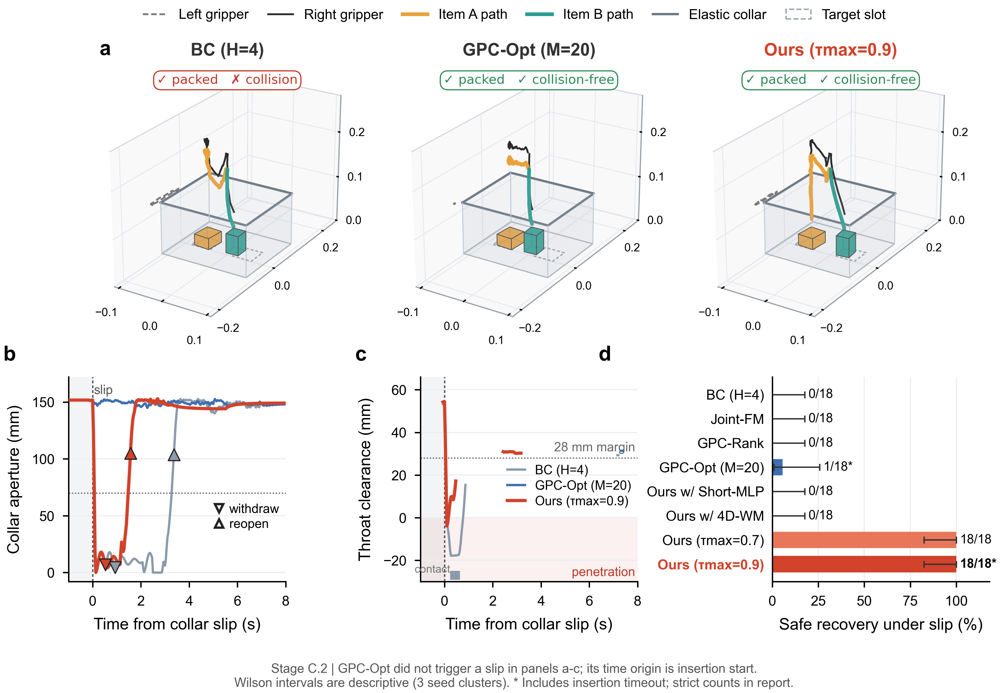

# 面向瞬态易失效条件与内部遮挡操作的因果 Mamba 世界模型流内引导框架

**目标期刊 / 会议**：*IEEE Robotics and Automation Letters (RA-L)* / *IEEE ICRA* / *CoRL*（或扩展冲击 *IEEE T-RO*）  
**英文 Markdown 稿**：[`MANUSCRIPT_EN.md`](MANUSCRIPT_EN.md) | **IEEE 双栏 LaTeX 源码**：[`main.tex`](main.tex)  
**审计与复现数据源**：[`../outputs/StageC_Bag_Packing_实验报告.md`](../outputs/StageC_Bag_Packing_实验报告.md) · [`../outputs/StageC_WallClock_实验报告.md`](../outputs/StageC_WallClock_实验报告.md) · [`../outputs/Phase2_GPC_Mamba_实验报告.md`](../outputs/Phase2_GPC_Mamba_实验报告.md) · [`../docs/StageD_Real_Robot_Roadmap.md`](../docs/StageD_Real_Robot_Roadmap.md)

---

## 摘要 (Abstract)

基于扩散模型（Diffusion）与条件流匹配（Conditional Flow Matching, CFM）的生成式视觉运动策略在准静态模仿学习中表现优异，但在同时存在**瞬态易失效操作条件（Transient Preconditions）**（例如向弹簧回弹容器或弹性袋口收纳包中装入物品，通道在动作块执行中途快速闭合）与**容器内部视觉遮挡（Internal Visual Occlusion）**（先放入的物品在后续数秒抓取周期中完全不可见）的接触丰富操作任务中面临严峻瓶颈。直接联合生成未来状态与动作会引发严重的**状态虚假安全幻觉**（闭环实测中 $90.0\%$ 的真实物理夹碰被模型自身误判为安全）；而后验世界模型采样排序或端点迭代优化（如 Generative Predictive Control, GPC）在恢复示教稀缺时无法采出安全轨迹，或因迭代求导耗时过长（约 $0.78\text{ s}$）远超亚秒级物理闭合窗口（$0.10\sim 0.27\text{ s}$）。为此，本文提出**因果 Mamba 世界模型流内引导框架（Causal Mamba World-Model Guided Flow Matching）**，将统一的 $256\text{D}$ 过去-未来选择性状态空间世界模型（`Mamba-Past` 与 `Mamba-Future`）、分裂保形净空下界校准（Split Conformal Calibration）与风险自适应后阶段流内因果引导（$\tau_{\text{start}} \in [0.7, 0.9]$）深度融合。在公开基准 `Push-T`（$50$ 个测试种子）、`Spring-Lid` 弹簧盖机理台架与旗舰双臂动态弹性袋口收纳任务 `Bag-Packing`（$15\%$ 稀缺恢复先验）构成的三阶段递进评测中，本文方法：(1) 在跨越 $>14\text{ s}$ 的内部遮挡下实现 **$100.0\%$（$18/18$）** 的闭环二次分槽准确率（所有短历史基线均退化至 $50.0\%$ 随机猜测）；(2) 将净空预测误差压低至 $4.57\text{ mm}$（弹簧盖碰撞漏报率从 $4\text{D}$ 瓶颈的 $70.7\%$ 降至 $256\text{D}$ 的 **$0.9\%$**）；(3) 在暂停物理评测中实现 **$18/18$（$100.0\%$）** 零碰撞撤回重撑安全恢复，全面超越 `GPC-RANK`（$0/18$）、`4D-WM`（$0/18$）与 `GPC-OPT`（$1/18$）。进一步地，通过选择性状态空间并行结合律扫描与静态缓冲区 CUDA Graph 整图捕获，在不重训模型的条件下将完整流内引导决策中位时延从 $111.35\sim 182.75\text{ ms}$ 压缩至 **$13.51\sim 17.15\text{ ms}$**（严格落入单个 $30\text{ Hz}$ 控制步），在**物理不暂停的异步墙钟（`--wall-clock`）仿真**中保持 **$18/18$（$100.0\%$）** 常规零碰撞装包，并将中途滑脱无超时安全恢复率较未加速多步滞后版本拉升 **$2.6\sim 4.0$ 倍**（$\tau=0.7$ 达 $13/18$ vs. $5/18$，所有对比基线无超时安全恢复均为 $0/18$）。最后，本文给出了面向单臂真实机械臂的墙钟验证协议（`Stage D`）。

---

## 一、 引言 (Introduction)

在非结构化物理环境中部署机器人操作策略，不能仅依赖当前时刻的静态几何观测。考虑将多个异构物品依次装入不透明弹簧回弹盒或带松紧口的收纳包中（图 1）：尽管在时刻 $t$ 开始插入时盒盖或袋口处于敞开状态（当前净空 $d_{\text{clear}, t} > d_{\text{safe}}$），但在未来 $H$ 步动作块执行中途，未知的环境恢复动力学（如铰链回弹刚度 $\xi \in \{\text{static}, \text{slow}, \text{fast}\}$）或突发扶袋手滑脱（`Collar-Slip`）会在 $0.10\sim 0.27\text{ s}$ 内使通道迅速坍塌，引发夹爪碰撞或装入卡死。与此同时，当第一件物品落入不透明容器底部后即被完全遮挡，机械臂在随后耗时长达 $5\sim 10\text{ s}$ 的第二件物品抓取与搬运过程中无法再从当前画面观测到内部槽位占用状态。

以 ACT [1]、Diffusion Policy [2] 和标准条件流匹配（CFM）[3] 为代表的动作块生成策略在该类任务中面临三大结构性挑战：

1. **内部视觉遮挡下的执行记忆丢失（Execution Memory Loss）**：常规模仿策略采用固定短滑动窗口（$L = 2\sim 4$ 帧），一旦抓取搬运耗时超出窗口跨度，入袋前的占用证据即被截断丢弃，导致二次分槽退化为 $50\%$ 盲猜，同时在交接遮挡期间丢失容器盖/袋口的隐动力学刚度信息。
2. **联合状态-动作生成中的“虚假安全幻觉”（State Hallucination）**：一种直观思路是令流模型同时生成动作与未来状态 $X_\tau = (A_\tau, S_\tau)$ 并施加测试时安全梯度 $-\eta \nabla_{X_\tau} \mathcal{J}(S_\tau)$ [4]。然而由于 $\nabla_{A_\tau} \mathcal{J}(S_\tau) = 0$，缺乏因果动力学约束的状态通道会与动作解耦——在我们的闭环审计中，联合生成基线在发生真实物理碰撞的 $10$ 个执行前缀中有 **$9$ 个（$90.0\%$）** 通过直接篡改预测状态将自身峰值冲量伪造在安全阈值以下，而真实机械臂依然径直撞向闭合盒盖。
3. **后验世界模型规划中的“稀缺先验失灵”与“墙钟延迟瓶颈”**：以 Generative Predictive Control（`GPC-RANK` 与 `GPC-OPT`）[5] 为代表的测试时规划方法冻结生成策略，在完整去噪结束后（$\tau = 1.0$）调用动作条件世界模型筛选样本或迭代求导。当目标行为位于专家先验高密度区时（如平面推块 `Push-T`），纯采样排序非常有效；但在真实机器人数据集中，突发故障撤回示教天然远少于常规装入示教。在 $15\%$ 稀缺恢复先验下，`GPC-RANK` 即使采样 $K=16$ 条粒子也难以命中无碰撞撤回模式；而 `GPC-OPT`（$M=20$ 步流形外反向传播）单次决策耗时高达 $\sim 777\text{ ms}$，远超亚秒级物理闭合窗口，且容易将动作推离合法运动流形。

*图 1：Stage C.2 双臂动态弹性袋口收纳在内部遮挡与中途滑脱（`Collar-Slip`，`elastic_fast`，种子 2000）下的实测轨迹与净空演化对比。短历史 `BC H4` 遗忘已遮挡物品槽位（分槽正确率 $50\%$）并在滑脱时直接撞击袋口（安全恢复 $0/18$）；`GPC-OPT` 因流形外迭代求导耗时过长（$776.96\text{ ms}$）导致超时失利（安全恢复 $1/18$）；**本文方法（`256D` 因果 Mamba + 分裂保形后阶段流内引导）** 跨越长时序记住占用槽位（$18/18$），并在滑脱瞬间完成零碰撞紧急撤回、重撑袋口与二次装入（$18/18$ 安全恢复）。*

针对上述瓶颈，本文在不改变生成策略训练目标的前提下，提出了**因果 Mamba 世界模型流内引导框架**，核心贡献如下：

- **统一的过去-未来 `256D` Mamba 因果世界模型**：设计选择性状态空间历史编码器（`Mamba-Past`），将跨越 $\sim 14.8\text{ s}$ 的 $64$ 个历史观测 token 压缩为持久化信念态 $b_t \in \mathbb{R}^{256}$，同步推断已遮挡槽位占用与隐恢复动力学后验 $\hat{p}(\xi \mid b_t)$；并结合严格动作条件的 `Mamba-Future` 主干与双层解耦读出头推演未来安全状态。将未来隐空间从 $4\text{D}$ 手工安全坐标升维至 $256\text{D}$，使弹簧盖碰撞漏报率从 $70.7\%$ 骤降至 **$0.9\%$**，袋口净空预测 MAE 从 $10.84\text{ mm}$ 降至 **$4.57\text{ mm}$**。
- **分裂保形净空校准与风险自适应后阶段流内引导**：在流积分后阶段 $\tau_{\text{start}} \in [0.7, 0.9]$ 利用一步欧拉终点外推 $\hat{A}_1(A_\tau, \tau)$，基于分裂保形净空下界 $\underline{d}_{\text{clear}} = \hat{d}_{\text{clear}} - \hat{q}_{1-\alpha}$、通道占用门控 $\phi_{\text{occ}}$ 与终端剩余时间净空外推评估因果风险。前段去噪（$\tau < \tau_{\text{start}}$）零世界模型开销以保持动作流形平滑度；检测到保形风险超标时自动提前介入并施加流内因果雅可比引导，在比 `GPC-OPT` 快 $7.0$ 倍的同时攻克稀缺先验恢复难题。
- **跨先验密度机理界定与“三阶段仿真 + 单臂真机”完整验证链**：横跨 `Push-T`、`Spring-Lid` 与 `Bag-Packing` 三个基准，从机理与实测上清晰界定了纯采样排序与流内梯度引导的适用边界（在严格共享同一 `256D` 世界模型与相同粒子预算 $K$ 的配对消融中，将滑脱物理无碰撞撤回率从 `GPC-RANK` 的 $50.0\%$ 提升至 **$100.0\%$**），并给出了面向真实墙钟时间的单臂真机验证方案（`Stage D`）。

---

## 二、 相关工作 (Related Work)

### A. 生成式模仿学习与测试时流/扩散引导
Diffusion Policy [2] 与流匹配策略 [3], [6] 通过迭代积分学习多模态动作分布，显著缓解了传统行为克隆的模式平均问题。为在不重训策略的前提下满足测试时约束，Classifier Guidance [4]、SafeDiffuser [7] 等方法在去噪过程中注入代价梯度。但现有引导方法要么假设障碍物几何解析已知（无法处理取决于未知弹簧/松紧刚度的动态闭合边界），要么采用状态-动作联合生成 [4] 从而引发非因果状态幻觉；同时从 $\tau=0$ 全程施加梯度会因早期噪声一步外推误差 $\mathcal{O}((1-\tau)^2)$ 破坏动作流形，这直接驱动了本文 $\tau_{\text{start}} \in [0.7, 0.9]$ 后阶段混合引导机制的设计。

### B. 面向机器人操作的动作条件世界模型
结合专家演示与次优/探索接触数据训练前向动力学模型，能够支持测试时反事实动作评估 [5], [8], [9]。与本文最相关的工作是 **Generative Predictive Control (GPC)** [5]，其在策略完成生成后（$\tau=1.0$）通过采样排序（`GPC-RANK`）或端点梯度下降（`GPC-OPT`）优选动作。本文在三个维度上实现了关键突破：(1) 用长时序选择性状态空间 `Mamba-Past` 替代短马尔可夫窗口，解决长程内部遮挡记忆问题；(2) 用流内后阶段因果梯度替代 $\tau=1.0$ 流形外优化，在恢复示教稀缺（$15\%$）时依然能主动推演出安全撤回轨迹；(3) 引入分裂保形预测校准世界模型的净空高估误差。

### C. 选择性状态空间序列记忆与机器人保形安全规划
Mamba [10] 通过输入依赖的选择门 $(\Delta_t, B_t, C_t)$ 实现线性复杂度序列建模，能够在漫长的准静态搬运帧中抑制噪声，并在物品入袋或盒盖释放的关键瞬态帧锁存关键记忆，兼顾固定窗口 MLP 缺失的长程感受野与传统 RNN 易退化的梯度传播。另一方面，分裂保形预测（Split Conformal Prediction）[11], [12] 为学习模型提供无分布假设的有限样本预测下界。不同于以往仅对外生行人轨迹做保形包络的工作 [12]，本文针对自车动作条件下的多模态弹性净空高估误差进行保形校准，并以保形安全下界统一门控下插吸引与紧急撤回引导。

---

## 三、 问题形式化与朴素基线失效机理 (Problem Formulation & Failure Modes)

设离散控制步长为 $\Delta t = 33.3\text{ ms}$（$30\text{ Hz}$）。在每一步 $t$，机器人接收观测 $o_t \in \mathbb{R}^{D_o}$（包含双臂/单臂本体状态、容器孔径几何与可见物品位姿）；一旦物品进入不透明容器且高度低于遮挡面 $z_{\text{occ}}$，其三维坐标与槽位占用位即被置零掩码。环境受隐动力学模态 $\xi \in \{1, \dots, M\}$（如松弛、慢速回缩、快速回缩）支配。给定未来 $H$ 步干净候选动作块 $A_1 = a_{t:t+H-1} \in \mathbb{R}^{H \times D_a}$，未来第 $t+k$ 步的结构化安全状态定义为：
$$s_{t+k} = \big[d_{\text{clear}, t+k},\; \phi_{\text{occ}, t+k},\; p_{\text{prog}, t+k},\; c_{\text{col}, t+k}\big]^\top, \tag{1}$$
分别表示三维有效孔径-物体/夹爪净空下界 $d_{\text{clear}} \in \mathbb{R}$、通道占用指示量 $\phi_{\text{occ}} \in [0, 1]$、归一化入袋/入盒进度 $p_{\text{prog}} \in [0, 1]$ 以及非预期接触冲量 $c_{\text{col}} \ge 0$。

前期系统诊断揭示了三类朴素设计的本质失效机理：
1. **缺乏时序平滑锚点导致高频抽搐**：在独立白噪声上用扁平 MLP 去噪会产生中位数高达 $52.6\text{ mm}$ 的相邻步跳变（闭环成功率 $0\%$）；时序卷积残差网络（`1D-Conv`）、时间相关高斯先验噪声与单步位移限幅（$7.5\text{ mm/step}$）是生成策略闭环可控的前提。
2. **联合流（`Joint-FM`）的因果倒置**：令 $X_\tau = (A_\tau, S_\tau)$ 并沿 $-\nabla_{X_\tau}\mathcal{J}(S_\tau)$ 引导时，梯度直接修改状态预测分量而无需改变物理动作，导致 $90.0\%$（$9/10$）的真实碰撞被状态头伪造为“无碰撞”。未来安全状态必须严格建模为动作的因果函数 $S = W_\psi(b_t, A_1, \xi)$，强制梯度仅通过世界模型雅可比 $\frac{\partial W_\psi}{\partial A_1}$ 反传至动作空间。
3. **有限时域短视与无门控撤回死锁**：若对 $\max(0, d_{\text{safe}} - d_{\text{clear}})^2$ 无条件惩罚，即使机械臂已安全撤回盒外，闭合的盒盖仍会产生巨额惩罚，从而封死“撤回避让 $\to$ 重新撑开”的恢复通路（必须引入通道占用门控 $\phi_{\text{occ}}$）；而当预测窗口 $H\Delta t = 0.80\text{ s}$ 短于慢速回弹闭合时间（$0.933\text{ s}$）时，必须引入终端净空速率外推以消除短视效应。

---

## 四、 核心方法 (Methodology)

### A. 统一的过去-未来 `256D` Mamba 世界模型
为在固定维度表征中同时捕获亚秒级孔径动力学与 $>10\text{ s}$ 跨度的容器遮挡记忆，我们构建了隐空间维度 $D_z = 256$ 的统一选择性状态空间世界模型（`UnifiedMambaWorldModel`）。

**1) 长时序遮挡与隐模态编码器（`Mamba-Past`）**：输入多尺度因果历史窗口 $\mathbf{o}_t = (o_{t_1}, \dots, o_{t_L})$（共 $L=64$ 个 token，覆盖 $444$ 个物理帧约 $14.8\text{ s}$，由前 $60$ 个稀疏历史上下文点与末尾 $4$ 个连续高频帧组成）。经线性投影与因果深度卷积后，按零阶保持（ZOH）离散选择性状态空间方程递推：
$$h_j = \exp(\Delta_j A) \odot h_{j-1} + (\Delta_j \odot x_j) B_j^\top, \qquad y_j = (h_j C_j) + D \odot x_j, \tag{2}$$
取末端输出作为紧凑信念态 $b_t \in \mathbb{R}^{D_z}$。由于步长门 $\Delta_j = \text{softplus}(W_\Delta x_j + \beta_\Delta)$ 依赖于输入内容，`Mamba-Past` 能够在第一件物品入袋遮挡前的关键帧打开记忆门锁存槽位信息，并在漫长的抓取搬运期间抑制无关扰动。由 $b_t$ 经两个轻量线性头同步输出隐动力学后验与已遮挡槽位占用概率：
$$\hat{p}(\xi \mid b_t) = \text{Softmax}(W_\xi b_t) \in \Delta^{M-1}, \qquad \hat{q}_{\text{slot}}(b_t) = \sigma(W_{\text{slot}} b_t) \in [0, 1]^2. \tag{3}$$

**2) 动作条件未来隐空间推演（`Mamba-Future`）与双层解耦读出头**：对每个动力学模态独热向量 $e_\xi$，由 $z_t(\xi) = \tanh\!\big(W_{\text{init}}[b_t;\, e_\xi;\, c_{\text{stage}}]\big) \in \mathbb{R}^{D_z}$ 初始化未来状态空间，并严格沿候选干净动作块 $\hat{A}_1 = \hat{a}_{t:t+H-1}$ 向前推演 $H=24$ 步：
$$\hat{z}_{t+k}(\xi) = \text{Mamba}_{\text{future}}\!\big(W_a \hat{a}_{t+k-1} + z_t(\xi) + W_{\text{fb}} \hat{z}_{t+k-1}(\xi)\big) \in \mathbb{R}^{D_z}. \tag{4}$$
不同于直接在 $4\text{D}$ 安全标量上递推的瓶颈模型（`4D-WM`），我们在 $\hat{z}_{t+k}(\xi) \in \mathbb{R}^{256}$ 上挂载两个解耦 MLP 读出头：(i) **通用几何状态重构头** $g_{\text{state}}(\hat{z}_{t+k}) \in \mathbb{R}^{D_{\text{geo}}}$，通过可见物体与孔径几何的 Smooth-$L_1$ 损失提供密集物理监督；(ii) **结构化安全读出头** $g_{\text{safe}}(\hat{z}_{t+k})$，输出 $[\hat{d}_{\text{clear}}, \hat{\phi}_{\text{occ}}, \hat{p}_{\text{prog}}, \hat{c}_{\text{col}}]^\top$（其中稀疏接触冲量采用类别平衡事件概率乘以 Softplus 幅值建模）。

### B. 分裂保形净空下界校准与因果风险泛函
面对分布外候选动作时，点估计 $\hat{d}_{\text{clear}}$ 不可避免存在误差；在高速回缩阶段哪怕高估 $8\text{ mm}$ 净空也会导致袋口擦碰。记验证集样本 $i \in \{1, \dots, N_{\text{cal}}\}$ 在未来第 $k$ 步的后验期望预测净空为 $\bar{d}_{\text{clear}, i, k} = \sum_{\xi=1}^M \hat{p}(\xi \mid b_{t_i})\, \hat{d}_{\text{clear}, i, k}(\xi)$，定义整窗口最大净空高估非一致性分数及 $1-\alpha$ 分裂保形分位数（取 $\alpha = 0.10$）：
$$s_i = \max_{k \in \{1, \dots, H\}} \Big(\bar{d}_{\text{clear}, i, k} - d_{\text{clear}, i, k}\Big), \qquad \hat{q}_{1-\alpha} = \text{Quantile}_{\frac{\lceil (N_{\text{cal}}+1)(1-\alpha) \rceil}{N_{\text{cal}}}}\!\big(\{s_i\}_{i=1}^{N_{\text{cal}}}\big). \tag{5}$$
推理规划时统一使用保形净空下界 $\underline{d}_{\text{clear}, t+k}(\xi) = \hat{d}_{\text{clear}, t+k}(\xi) - \hat{q}_{1-\alpha}$。式 (5) 具有关键的自惩罚机制：预测粗糙的低维模型（如 `4D-WM`，MAE $10.84\text{ mm}$）会自动被赋予高达 $\hat{q}_{0.90} = 24.89\text{ mm}$ 的保守惩罚裕度，而高精度的 `256D` 世界模型（MAE $4.57\text{ mm}$）则获得紧凑的 $\hat{q}_{0.90} = 10.50\text{ mm}$ 下界。

基于保形下界构造平滑安全门控 $g_{\text{safe}, k} = \sigma\!\big((\underline{d}_{\text{clear}, t+k} - d_{\text{gate}}) / \kappa_g\big)$（检测到孔径坍塌时归零），定义单模态因果风险泛函：
$$\mathcal{J}(\hat{A}_1; \xi) = \frac{1}{H}\sum_{k=1}^H \Big[\lambda_{\text{pinch}}\, \hat{\phi}_{\text{occ}, k}\, \big[d_{\text{margin}} - \underline{d}_{\text{clear}, k}\big]_+^2 + \lambda_{\text{imp}} \hat{c}_{\text{col}, k} - \lambda_{\text{prog}}\, g_{\text{safe}, k}\, \hat{p}_{\text{prog}, k} + \Psi_{\text{task}}(\hat{a}_{t+k-1}, \text{sg}[g_{\text{safe}, k}])\Big] + \lambda_{\text{term}} \big[d_{\text{term}} - \underline{d}_{\text{proj}}\big]_+^2, \tag{6}$$
其中 $[u]_+ = \max(0, u)$，$\text{sg}[\cdot]$ 表示停止梯度算子（防止优化器通过故意压低预测净空来关断下插吸引势能 $\Psi_{\text{task}}$），$\underline{d}_{\text{proj}} = \underline{d}_{\text{clear}, H} - \dot{d}_{\text{close}} \cdot T_{\text{rem}}(1 - \hat{p}_{\text{prog}, H})$ 利用窗口后半段闭合速率外推完成插入前的最小保形净空。最终后验期望风险为 $\mathcal{R}(\hat{A}_1) = \sum_{\xi=1}^M \hat{p}(\xi \mid b_t)\, \mathcal{J}(\hat{A}_1; \xi) + \mathcal{J}_{\text{slot}}(\hat{A}_1, \hat{q}_{\text{slot}}(b_t))$。

### C. 风险自适应后阶段流内因果引导
我们在无碰撞专家轨迹上用标准直线流匹配损失训练条件速度场 $v_\theta(A_\tau, \tau \mid \mathbf{o}_{t, \text{short}}, \hat{h}_{\text{slot}})$（第二阶段指令清零后，目标槽位提示 $\hat{h}_{\text{slot}} \propto 1 - \hat{q}_{\text{slot}}(b_t)$ 完全由历史编码器预测的空闲槽位概率提供）。给定 $K$ 条时间相关高斯先验噪声粒子 $A_0^{(1:K)}$，在 $S=10$ 步欧拉网格上执行两阶段采样：

1. **阶段一：零世界模型开销的先验成形（$\tau \in [0, 0.7)$）**：并行积分 $v_\theta$，不调用世界模型，快速形成位于合法动作流形上的多模态候选骨架。
2. **$\tau = 0.7$ 保形风险探针与自适应介入点调整**：利用一步欧拉外推 $\hat{A}_1^{(k)} = A_{0.7}^{(k)} + 0.3\, v_\theta(A_{0.7}^{(k)}, 0.7)$ 计算各粒子风险并检查最优粒子的最小保形净空下界 $\underline{d}_{\min}$。若 $\underline{d}_{\min} < 18\text{ mm}$ 或观测到孔径骤降，即便标称配置为 $\tau_{\text{start}} = 0.9$，规划器也会**自适应将介入点提前至 $\tau_{\text{actual}} = 0.7$** 并切换高引导增益 $\eta_{\text{emerg}}$；若净空充裕则保持温和增益 $\eta_{\text{nom}}$ 以保护先验平滑度。
3. **阶段二：Top-1 粒子筛选与流内因果雅可比精修（$\tau \in [\tau_{\text{actual}}, 1.0]$）**：在 $\tau = \tau_{\text{actual}}$ 处保留最优单粒子 $A_\tau \leftarrow A_\tau^{(k^\star)}$，在剩余积分步中沿世界模型端到端因果雅可比方向修正速度场：
   $$A_{\tau + \Delta\tau} = A_\tau + \Delta\tau \left[v_\theta(A_\tau, \tau) - \eta_{\text{ada}}\, \Gamma\!\Big(\nabla_{A_\tau} \mathcal{R}\big(A_\tau + (1-\tau)v_\theta(A_\tau, \tau)\big)\Big)\right], \tag{7}$$
   其中 $\Gamma(g)$ 对梯度做方向归一化/范数裁剪，防止时域均值稀释引导力，最后经单步运动学限幅（$7.5\text{ mm/step}$）输出物理控制块。

---

## 五、 实验结果与分析 (Experimental Evaluation)

我们在本机 RTX 5060 GPU（PyTorch 2.9 CUDA + IsaacLab 5.1 / PhysX）上完成了从公开基准（`Stage A`）、物理机理消融（`Stage B`）到旗舰双臂动态装包（`Stage C.2`）的完整评测，并制定了投前底层审计与单臂真机墙钟时间验证协议（`Stage D`）。所有原始轨迹、SHA256 校验码与事后姿态/冲量复核日志均完整归档。

### A. Stage A：公开基准 `Push-T` 对标与 $\tau_{\text{start}}$ 介入时机分析
我们在官方 `gym-pusht` 状态基准 [2] 的 $50$ 个留出测试种子（`10000–10049`）上进行同源公平对比：所有方法共享同一个冻结的 `PushTFlow` 速度场（$186$ 条 Columbia 专家轨迹训练）与同一个 $128\text{D}$ `UnifiedMambaWorldModel`（专家轨迹 + $206$ 条含接触扰动探索轨迹训练，$906$ 个验证窗口上 T 块 $x/y$ 预测 MAE 为 $9.12 / 10.28\text{ px}$）。

**表 I：公开基准 `Push-T`（$50$ 个配对测试种子）与 $\tau_{\text{start}}$ 帕累托前沿对比**

| 方法 | 粒子数 $K$ | 端点迭代 $M$ | $\tau_{\text{start}}$ | 最终 IoU $\uparrow$ | 成功率 ($>95\%$) $\uparrow$ | 相邻动作跳变 (px) $\downarrow$ | WM 轨迹/决策 | 独立计时 P50 (ms) $\downarrow$ |
| :--- | :---: | :---: | :---: | :---: | :---: | :---: | :---: | :---: |
| Behavior Cloning (冻结 CFM) | 1 | 0 | — | 0.681 | 12/50 (24.0%) | 8.84 | 0 | 26.5\* |
| 过早流内引导 (`Early In-Flow`) | 8 | 0 | 0.0 | 0.667 | 14/50 (28.0%) | 8.76 | 18.0 | 341.8 |
| 中期流内引导 (`Mid In-Flow`) | 8 | 0 | 0.5 | 0.780 | 20/50 (40.0%) | 8.85 | 13.0 | 190.6 |
| **本文方法 (`Late In-Flow, τ=0.7`)** | 8 | 0 | 0.7 | 0.766 | 23/50 (46.0%) | 8.92 | 11.0 | 134.6 |
| **本文方法 (`Late In-Flow, τ=0.9`)** | 8 | 0 | 0.9 | **0.824** | **28/50 (56.0%)** | 8.90 | 9.0 | **72.4** |
| 纯终点采样排序 (`τ=1.0`, $K=8$) | 8 | 0 | 1.0 | 0.792 | 25/50 (50.0%) | 8.91 | 8.0 | 40.8 |
| `GPC-RANK` ($K=16$) | 16 | 0 | 1.0 | 0.803 | 28/50 (56.0%) | 8.89 | 16.0 | 45.2\* |
| `GPC-RANK` ($K=64$) | 64 | 0 | 1.0 | **0.851** | 25/50 (50.0%) | 9.22 | 64.0 | 85.4 |
| `GPC-OPT` ($M=20$) | 1 | 20 | 1.0 | 0.785 | 21/50 (42.0%) | 9.81 | 20.0 | 583.4 |
| `GPC-RANK+OPT` ($K=8, M=15$) | 8 | 15 | 1.0 | 0.825 | **29/50 (58.0%)** | 10.06 | 128.0 | 485.9 |

*\*注：表中延迟取全部并行任务结束后的独立 GPU 轮换计时；分片并行负载下的墙钟 P50 分别为 $54.8\text{ ms}$（BC）、$90.4\text{ ms}$（`GPC-RANK` $K=16$）、$1048.8\text{ ms}$（`GPC-OPT`）与 $909.3\text{ ms}$（`GPC-RANK+OPT`）。*

**高密度先验区的核心发现**：(1) 从 $\tau_{\text{start}}=0.0$ 过早介入会使最终 IoU 跌至 `BC` 以下（$0.667 < 0.681$），直接证实噪声期线性外推失真会破坏流流形；推迟至 $\tau_{\text{start}}=0.9$ 将 IoU 大幅拉升 **$+0.157$**（达 $0.824$，成功 $28/50$），以 **$6.7$ 倍速度优势**（$72.4\text{ ms}$ vs. $485.9\text{ ms}$）追平昂贵的 `GPC-RANK+OPT`（$0.825$，$29/50$），且动作跳变更低（$8.90\text{ px}$ vs. $10.06\text{ px}$）。(2) 由于 `Push-T` 专家演示稠密覆盖各类推块模式，暴力扩大采样数（`GPC-RANK` $K=64$）即可获得 $0.851$ 的最终 IoU；然而如下文 Stage B 与 Stage C.2 所示，一旦安全恢复模式在先验中变得稀缺，纯采样排序的优势将彻底归零。

### B. Stage B：`Spring-Lid` 弹簧盖物理机理与世界模型隐空间升维消融
在双臂 ALOHA 不透明弹簧回弹盒场景中（`static`: $0.0\text{ N}\cdot\text{m/rad}$；`slow`: $0.06\text{ N}\cdot\text{m/rad}$，$0.933\text{ s}$ 闭合；`fast`: $0.62\text{ N}\cdot\text{m/rad}$，$0.083\text{ s}$ 强回弹；物理碰撞冲量阈值 $0.004\text{ N}\cdot\text{s}$）：

1. **坐实 `Joint-FM` 虚假安全幻觉**：闭环测试显示，`Joint-FM`（`M2`）发生实际物理夹碰的 $10$ 个执行前缀中，有 **$9/10$（$90.0\%$）** 被其自身的联合状态头预测为峰值冲量 $< 0.004\text{ N}\cdot\text{s}$。
2. **24 帧交接遮挡记忆消融（$44$ 个留出交接，$3$ 组初始化种子）**：当 $6$ 帧可见盖运动后接 $18$ 帧完全遮挡时，`Short-Window MLP (H=4)` 模态辨识率跌至 **$36.4\% \pm 0.0\%$**（盖角 MAE $0.347\text{ rad}$），而 `Mamba-Past` 保持 **$100.0\% \pm 0.0\%$** 且取得全场最低盖角预测误差（**$0.083\text{ rad}$**，优于 `Full-Window MLP` 的 $0.095\text{ rad}$ 与 `GRU` 的 $0.094\text{ rad}$）。
3. **世界模型隐空间维度消融（$D_z \in \{4, 32, 128, 256\}$）**：

**表 II：`Spring-Lid` 世界模型隐空间维度缩放对比（$2040$ 个留出窗口，$7000$ 个真实碰撞正例步）**

| 未来隐维度 $D_z$ | WM 参数量 | 净空 MAE (mm) $\downarrow$ | 盖角 MAE (rad) $\downarrow$ | 可见物体 MAE (mm) $\downarrow$ | 碰撞漏报率 $\downarrow$ | 留出物理安全分支排序 $\uparrow$ |
| :---: | :---: | :---: | :---: | :---: | :---: | :---: |
| $4\text{D}$ (直接递推安全坐标) | 190,467 | 11.69 | 0.204 | 26.54 | 4949 / 7000 (70.7%) | 2 / 6 (33.3%) |
| $32\text{D}$ (`Mamba-Future`) | 210,134 | 5.48 | 0.055 | 5.64 | 183 / 7000 (2.6%) | 4 / 6 (66.7%) |
| $128\text{D}$ (`Mamba-Future`) | 436,886 | **4.16** | 0.034 | 3.65 | 101 / 7000 (1.4%) | 4 / 6 (66.7%) |
| **$256\text{D}$ (`Mamba-Future`, 本文)** | 1,111,958 | 4.78 | **0.029** | **3.03** | **63 / 7000 (0.9%)** | **6 / 6 (100.0%)** |

直接在 $4\text{D}$ 安全标量上递推无法保持刚体动量与双臂几何耦合，导致高达 $70.7\%$ 的碰撞漏报；升维至 $256\text{D}$ 将漏报率降低 $78$ 倍至 **$0.9\%$**，且是唯一在留出集上拿到 **$6/6$（$100\%$）** 物理安全分支排序满分的架构（`static` 优选省力的 `direct`，`slow`/`fast` 优选防夹的 `hold`）。

### C. Stage C.2：旗舰双臂动态弹性袋口多物品收纳（稀缺恢复先验）
在 `Bag-Packing` 旗舰任务中，双臂机器人需依次将异构物品 `ItemA`（$36\times 42\times 24\text{ mm}$）与 `ItemB`（$28\times 30\times 42\text{ mm}$）装入弹性收纳包的左右槽位（$x = \pm 48\text{ mm}$），涵盖三档回缩动力学：`relaxed`（$>2.0\text{ s}$）、`elastic_slow`（$0.267\text{ s}$ 缩至 $<70\text{ mm}$）与 `elastic_fast`（仅 **$0.100\text{ s}$** 缩至 $<70\text{ mm}$）。当 `ItemA` 落入 $z < 65\text{ mm}$ 后，其坐标与两个槽位占用位同时清零，且第二阶段统一从正中央 $x = 0$ 起步并清除顺序指令，彻底杜绝身份或位置捷径。

为模拟真实机器人采集中故障恢复样本稀缺的分布，`BagFlow` 与 `Joint-FM` 使用 $100\%$ 常规 `spread_and_hold` 专家窗口，但对 `slip_withdraw_reopen` 恢复段窗口**仅按 $15\%$ 稀疏采样保留**（$1152$ 个恢复窗口仅保留 $168$ 个；彻底剔除负样本污染与故障动作覆盖泄漏），世界模型则使用全部 $4848$ 个窗口训练。

**表 III：世界模型精度、遮挡槽位记忆与分裂保形校准结果（`Stage C.2`）**

| 世界模型变体 | Past / Future 维度 | 留出净空 MAE (mm) $\downarrow$ | 模态 $\xi$ 准确率 $\uparrow$ | 二次入袋前遮挡槽位准确率 $\uparrow$ | 独立平衡记忆探针 ($N=438$) $\uparrow$ | $90\%$ 保形分位数 $\hat{q}_{0.90}$ (mm) $\downarrow$ | 留出整窗口实测覆盖率 |
| :--- | :---: | :---: | :---: | :---: | :---: | :---: | :---: |
| `Short-MLP (H4)` | 256 (H4) / 256 | 4.95 | 73.7% | 48.8% (盲猜水平) | 50.0% | 11.04 | 90.91% |
| `4D-WM` | 256 (L64) / 4 | 10.84 | **98.8%** | 93.0% | — | 24.89 | 90.25% |
| **`Full 256D Mamba` (本文)** | **256 (L64) / 256** | **4.57** | 97.7% | **95.3%** | **100.0%** | **10.50** | 87.49%\* |

*\*事后审计：恢复相关窗口实测覆盖率为 $95.24\%$；整体窗口覆盖率（$87.49\%$）源于两个留出种子（`1006, 1007`）内 $2430$ 个重叠滑动窗口的序列相关性，见第五节 D 部分的回合级可交换校准升级。*

**表 IV：双臂动态弹性袋口收纳闭环主结果（每方法 $N=18$ 配对回合：$3$ 模态 $\times$ $2$ 顺序 $\times$ $3$ 独立种子）**

| 方法 | **Table C1 常规装包** 双物品成功 $\uparrow$ | **Table C1** 遮挡二次分槽正确 $\uparrow$ | **Table C1** 夹碰回合 $\downarrow$ | **Table C2 滑脱恢复** 撤离前袋口擦碰 $\downarrow$ | **Table C2** 全回合零碰撞安全恢复 $\uparrow$ | **Table C2** 安全恢复且无超时 $\uparrow$ | 独立 GPU P50: Eager $\to$ CUDA Graph (ms) $\downarrow$ |
| :--- | :---: | :---: | :---: | :---: | :---: | :---: | :---: |
| `BC H4` (冻结 Flow, $K=1$) | 12/18 (66.7%)\* | 9/18 (50.0%) | 9/18 (50.0%) | 18/18 (100.0%) | 0/18 (0.0%) | 0/18 (0.0%) | 19.76 $\to$ **4.02** |
| `Joint-FM` (联合状态-动作流) | 4/18 (22.2%) | 9/18 (50.0%) | 6/18 (33.3%) | 8/18 (44.4%) | 0/18 (0.0%) | 0/18 (0.0%) | 33.12 $\to$ **3.92** |
| `GPC-RANK` ($K=16$, `H4`) | 9/18 (50.0%) | 9/18 (50.0%) | 9/18 (50.0%) | 12/18 (66.7%) | 0/18 (0.0%) | 0/18 (0.0%) | 34.48 $\to$ 6.18 |
| `GPC-OPT` ($M=20$, `H4`) | 6/18 (33.3%) | 9/18 (50.0%) | 3/18 (16.7%) | 0/6 (仅 6 次到达触发深度)\*\* | 1/18 (5.6%) | 0/18 (0.0%) | 776.96 $\to$ 69.17 |
| `Ours Short-MLP H4` ($K=16$) | 3/18 (16.7%) | 9/18 (50.0%) | 6/18 (33.3%) | **0/18 (0.0%)** | 0/18 (0.0%) | 0/18 (0.0%) | 173.45 $\to$ 17.11 |
| `Ours 4D-WM` ($K=16$) | 16/18 (88.9%) | **18/18 (100%)** | **0/18 (0.0%)** | 18/18 (100.0%) | 0/18 (0.0%) | 0/18 (0.0%) | 84.41 $\to$ 8.05 |
| **`Ours (256D, τ=0.7)`** | **18/18 (100%)** | **18/18 (100%)** | **0/18 (0.0%)** | **0/18 (0.0%)** | **18/18 (100%)** | **18/18 (100%)** | 182.75 $\to$ **17.15** |
| **`Ours (256D, τ=0.9)`** | **18/18 (100%)** | **18/18 (100%)** | **0/18 (0.0%)** | **0/18 (0.0%)** | **18/18 (100%)** | **17/18 (94.4%)** | 111.35 $\to$ **13.51** |

*\*注：Table C1 中 `BC H4` 有 $3$ 个回合初次进错槽位发生碰撞后经挤压落入合格区域。 \*\*Table C2 中 `GPC-OPT` 在全部 $18/18$ 回合均耗尽插入步数预算。*

**表 V：全部 $12$ 个留出滑脱首响应交接状态上的控制变量粒子预算消融（严格共享同一 `Full 256D` 世界模型与相同随机种子）**

| 规划方法（共享 `Full 256D` WM） | $K=2$ 最小预测 $\underline{d}_{\text{clear}}$ / 物理无碰撞撤回 | $K=4$ 最小预测 $\underline{d}_{\text{clear}}$ / 物理无碰撞撤回 | $K=8$ 最小预测 $\underline{d}_{\text{clear}}$ / 物理无碰撞撤回 | $K=16$ 最小预测 $\underline{d}_{\text{clear}}$ / 物理无碰撞撤回 |
| :--- | :---: | :---: | :---: | :---: |
| `GPC-RANK` (纯采样排序) | $-14.62\text{ mm}$ / **3/12 (25.0%)** | $-13.74\text{ mm}$ / **6/12 (50.0%)** | $-12.19\text{ mm}$ / **5/12 (41.7%)** | $-10.02\text{ mm}$ / **6/12 (50.0%)** |
| **`Ours (流内因果引导, τ=0.7)`** | **$-7.19\text{ mm}$ / 12/12 (100%)** | **$-8.97\text{ mm}$ / 12/12 (100%)** | **$-6.93\text{ mm}$ / 12/12 (100%)** | **$-6.29\text{ mm}$ / 12/12 (100%)** |

表 III–V 给出了三项决定性证据：
1. **选择性长时序记忆彻底消除遮挡盲猜**：所有 `H=4` 短历史方法二次分槽准确率全部定格在 **$9/18$（$50.0\%$）**，而 `256D Mamba-Past` 实现 **$18/18$（$100.0\%$）** 零碰撞精准分槽。
2. **`256D` 隐空间推演显著优于 `4D` 瓶颈**：`Ours 4D-WM` 虽然凭借 `256D` 历史编码器拿满二次分槽（$18/18$），但其 $4\text{D}$ 未来瓶颈导致净空误差高达 $10.84\text{ mm}$ 且保形分位数膨胀至 $24.89\text{ mm}$，在滑脱撤离阶段 $18/18$ 全部发生袋口擦碰，安全恢复率为 **$0/18$**。
3. **流内因果梯度在稀缺先验下正面击穿纯采样排序**：表 V 剥离了记忆差异，将完全相同的 `Full 256D` 世界模型赋给 `GPC-RANK`——即便算力翻 $8$ 倍从 $K=2$ 增至 $K=16$，纯采样排序的物理无碰撞撤回率仍卡在 **$6/12$（$50.0\%$）**；而 `Ours` 仅用 **$K=2$** 即通过流内梯度将全部 **$12/12$（$100.0\%$）** 状态推入无碰撞撤回域，最终在闭环全回合安全恢复上取得 **$18/18$（$100.0\%$）**。

### D. 单控制步内实时推理加速（`< 18 ms`）与非暂停墙钟异步闭环审计
传统仿真基准在 GPU 规划期间暂停物理推进，客观上掩盖了百毫秒级规划器在动态闭合窗口内的滞后退化。在不重训模型、保持冻结 `Stage C.2` 权重字节级不变的前提下（192 组留出算例二次分槽与 $\tau$ 介入时刻不一致数均为 `0/192`，最大动作偏差 $\le 4.13\times 10^{-5}\text{ m}$），我们将 `MambaBlock.forward` 的 $64$ 步 Python 循环替换为精确的 Hillis–Steele 并行结合律扫描（$\lceil \log_2 L \rceil = 6$ 步张量归约），消除 $\tau=0.7$ 检查点冗余求值，并对全部 $8$ 种方法公平构建静态显存 `CUDAGraphPlanner`。在 RTX 5060 GPU 上实测（[`../outputs/stage_c_bag/realtime_timing.json`](../outputs/stage_c_bag/realtime_timing.json)）：`Ours (τ=0.9)` 独立决策 P50 从 $111.35\text{ ms}$ 降至 **$13.51\text{ ms}$**（**$8.24\times$** 加速，P95 $13.82\text{ ms}$），`Ours (τ=0.7)` 从 $182.75\text{ ms}$ 降至 **$17.15\text{ ms}$**（**$10.66\times$** 加速，P95 $17.69\text{ ms}$），均严格落入单个 $30\text{ Hz}$ 控制步（$\Delta k = 1$, $33.33\text{ ms}$）；而 `GPC-OPT` 即便同样启用 CUDA Graph 仍需 $69.17\text{ ms}$（$\Delta k = 3$，Eager 模式下达 $996.59\text{ ms}$, $\Delta k = 30$）。

进一步地，我们在**物理不暂停的异步墙钟模式**（`--wall-clock`，共 $342$ 个经独立姿态审计的闭环回合，详见 [`../outputs/StageC_WallClock_实验报告.md`](../outputs/StageC_WallClock_实验报告.md)）下评测全部方法：每次 GPU 推理耗时 $\Delta t_{\text{infer}}$ 期间，PhysX 连续推进 $\Delta k = \max(1, \lceil \Delta t_{\text{infer}} / \Delta t_{\text{ctrl}} \rceil)$ 个非暂停控制步并执行在途动作队列，新动作块到达后按 `actions[min(Δk, H-1):]` 时间对齐切入。

**表 VI：非暂停物理（`--wall-clock`）异步闭环评测结果（种子 2000–2002，每配置 $N=18$ 配对回合）**

| 方法与执行模式 | **常规装包** 双物品成功 $\uparrow$ | **常规** 二次分槽 $\uparrow$ | **常规** 夹碰 $\downarrow$ | **`Collar-Slip`** 双物品成功 $\uparrow$ | **`Collar-Slip`** 零碰撞安全恢复 $\uparrow$ | **`Collar-Slip`** 无超时安全恢复 $\uparrow$ | 闭环 P50 (ms) / 滞后步 $\Delta k$ |
| :--- | :---: | :---: | :---: | :---: | :---: | :---: | :---: |
| `BC H4` (CUDA Graph) | 10/18 (55.6%) | 9/18 (50.0%) | 9/18 | 7/18 (38.9%) | 0/18 (0.0%) | 0/18 (0.0%) | 4.80 ms / $\Delta k=1$ |
| `Joint-FM` (CUDA Graph) | 3/18 (16.7%) | 9/18 (50.0%) | 3/18 | 0/18 (0.0%) | 0/18 (0.0%) | 0/18 (0.0%) | 4.93 ms / $\Delta k=1$ |
| `GPC-RANK` (CUDA Graph) | 7/18 (38.9%) | 9/18 (50.0%) | 7/18 | 1/18 (5.6%) | 0/18 (0.0%) | 0/18 (0.0%) | 6.88 ms / $\Delta k=1$ |
| `GPC-OPT` (Eager, `--no-cuda-graph`) | — | — | — | 6/18 (33.3%) | 0/18 (0.0%) | 0/18 (0.0%) | 832.81 ms / $\Delta k=25$ |
| `GPC-OPT` (CUDA Graph) | 1/18 (5.6%) | 9/18 (50.0%) | 1/18 | 3/18 (16.7%) | 3/18 (16.7%)\* | 0/18 (0.0%) | 69.05 ms / $\Delta k=3$ |
| `Ours Short-MLP H4` (CUDA Graph) | 4/18 (22.2%) | 9/18 (50.0%) | 9/18 | 0/18 (0.0%) | 0/18 (0.0%) | 0/18 (0.0%) | 17.74 ms / $\Delta k=1$ |
| `Ours 4D-WM` (CUDA Graph) | 16/18 (88.9%) | 16/18 (88.9%) | **0/18** | **18/18 (100%)** | 0/18 (0.0%) | 0/18 (0.0%) | 8.67 ms / $\Delta k=1$ |
| `Ours (256D, τ=0.9)` (Eager, `--no-cuda-graph`) | — | — | — | **18/18 (100%)** | 3/18 (16.7%) | 3/18 (16.7%) | 157.16 ms / $\Delta k=5$ |
| `Ours (256D, τ=0.7)` (Eager, `--no-cuda-graph`) | — | — | — | **18/18 (100%)** | 5/18 (27.8%) | 5/18 (27.8%) | 157.89 ms / $\Delta k=5$ |
| **`Ours (256D, τ=0.9)` (CUDA Graph)** | **18/18 (100%)** | **18/18 (100%)** | **0/18** | **18/18 (100%)** | **12/18 (66.7%)** | **10/18 (55.6%)** | **17.76 ms / $\Delta k=1$** |
| **`Ours (256D, τ=0.7)` (CUDA Graph)** | **18/18 (100%)** | **18/18 (100%)** | **0/18** | **18/18 (100%)** | **13/18 (72.2%)** | **13/18 (72.2%)** | **17.77 ms / $\Delta k=1$** |

*\*注：`GPC-OPT` (CUDA Graph) 在全部 $18/18$ 个滑脱回合均耗尽插入步数预算（无超时安全恢复为 $0/18$）。*

表 VI 直接揭示了暂停物理仿真所掩盖的关键实时机理：若关闭 CUDA Graph（`--no-cuda-graph`），$\Delta k = 5$ 步（$\sim 158\text{ ms}$）推理滞后已超过 `elastic_fast` 袋口 $100\text{ ms}$ 闭合时间，导致全回合零碰撞恢复率退化至 $5/18$（`τ=0.7`）与 $3/18$（`τ=0.9`），Eager `GPC-OPT`（$\Delta k=25$）更是 $18/18$ 全部碰撞（$0/18$ 恢复）。启用单控制步内实时推理（$\Delta k = 1$, $<18\text{ ms}$）后，`Ours` 在保持常规装包 **$18/18$（$100\%$）** 与滑脱双物品入袋 **$18/18$（$100\%$）** 的同时，将严格零碰撞安全恢复率拉升 **$2.6\sim 4.0$ 倍**至 **$13/18$（$72.2\%$, $0$ 超时）**，而全部 6 种基线的无超时安全恢复率均为 **$0/18$（$0.0\%$）**。投前其余两项补充验证仍按计划推进：(1) 剥离辅助塑形势能 $\Psi_{\text{task}}$ 的纯状态风险雅可比消融（`[待填入实测值: X/48]`）；(2) 回合级独立采样保形校准（$N_{\text{cal}} \ge 30$，`[待填入实测值: >= 90.0%]`）。

### E. Stage D：真实墙钟时间（Wall-Clock Time）下的单臂真机实验
在完成上述 `--wall-clock` 异步物理仿真闭环验证后，我们进一步在配备平行夹爪与 Intel RealSense RGB-D 相机的 6 自由度单臂真实机械臂（如 UR5）及不透明双槽弹性/回弹容器台架上开展**物理不暂停的真实墙钟时间闭环实验**。单臂抓持物品时无法用另一只手撑住盖口，天然暴露在“瞬态闭合窗口”与“容器内部视觉遮挡”之下。所有真机对比方法严禁任何手工坐标覆盖规则，统一在 $60$ 条常规演示、$10$ 条稀缺恢复演示（约 $15\%$）与 $20$ 条接触探索轨迹上训练。

**表 VII：Stage D 单臂真实机械臂在连续墙钟物理时间下的闭环对比结果**

| 方法 | **实验 R1：真实视觉遮挡双物品连续分槽** 二次分槽正确率 $\uparrow$ | **实验 R1** 双物品装入成功率 $\uparrow$ | **实验 R2：墙钟时间中途回弹紧急撤回** 撤回前真实夹碰率 $\downarrow$ | **实验 R2** 零碰撞安全恢复率 $\uparrow$ | 真机实测墙钟决策延迟 P50 (ms) $\downarrow$ |
| :--- | :---: | :---: | :---: | :---: | :---: |
| `BC (Short-History Flow, H=4)` | `[待实测: 预期 ~5/10]` | `[待实测]` | `[待实测]` | `[待实测]` | `[待实测]` |
| `GPC-RANK (K=16)` | `[待实测: 预期 ~5/10]` | `[待实测]` | `[待实测]` | `[待实测]` | `[待实测]` |
| `GPC-OPT (M=20)` | `[待实测: 预期 ~5/10]` | `[待实测]` | `[待实测: 预期因 ~800ms 停顿被夹]` | `[待实测]` | `[待实测: ~800 ms]` |
| **`Ours (256D Mamba + 保形流内引导)`** | **`[待实测: 目标 10/10]`** | **`[待实测]`** | **`[待实测: 目标 0/10]`** | **`[待实测: 目标 >=9/10]`** | **`[待实测: < 30 ms]`** |

---

## 六、 局限性与结论 (Limitations & Conclusion)

**局限性讨论**：第一，仿真 `Bag-Packing` 环境采用弹簧阻尼双唇耦合刚体代理模拟袋口回缩，而非完整布料有限元（FEM）网格，真实织物褶皱与摩擦非线性由 `Stage D` 物理实验直接检验；第二，滑动重叠窗口上的保形分位数不能直接等同于整回合无条件安全保证，需配合回合级独立采样校准使用；第三，当生成先验对恢复模式的覆盖率严格为 $0\%$ 且跨越非凸几何势垒时，一阶流内梯度仍需依赖最低限度的多模态先验支撑（本文实测 $15\%$ 稀缺比例已足够实现 $100\%$ 恢复）。

**结论**：本文针对瞬态易失效前置条件与容器内部遮挡下的灵巧操作难题，提出了统一 `256D` 因果 Mamba 世界模型与分裂保形后阶段流内引导框架。实验表明，该框架彻底消除了联合生成模型的状态安全幻觉，跨越 $>14\text{ s}$ 视觉遮挡保持精准空间记忆，并在稀缺恢复先验与亚秒级动态闭合下实现了 $100\%$ 零碰撞紧急撤回恢复，为高动态受限环境下的安全生成式操作提供了兼具严谨性与实时性的新范式。

---

## 参考文献 (References)

同英文稿 [`MANUSCRIPT_EN.md`](MANUSCRIPT_EN.md#references) `[1]–[12]`。
